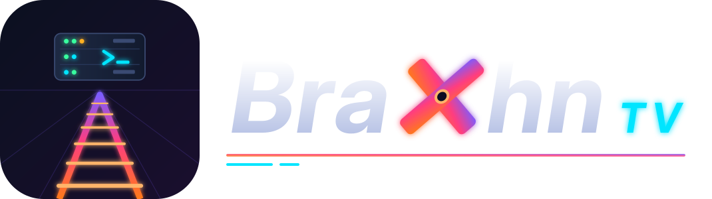

# BraXhn TV – your own media server for Unraid

English · [Svenska](README.md)

<p align="center"></p>

I built BraXhn TV so that my family would have everything we watch and listen to in one place – movies, TV shows, music, audiobooks, podcasts, photos and live TV – on our own Unraid server. No account with anyone else, no cloud service and no subscription.

The server is written from scratch in Node.js with no npm dependencies, and uses ffmpeg for streaming. It ships as one Docker image (`ghcr.io/braxhn/braxhn-tv`, amd64 and arm64), signed with Sigstore. You watch in the browser (also on the TV, with the remote), in the app for iPhone, iPad and Apple TV, or in the Android app on Google TV and in the car. Subsonic music apps, DLNA, Chromecast and AirPlay work too.

We're a Swedish family, so the project is Swedish first: the code, the native apps and some of the documentation are in Swedish. The web app is in English and Swedish, and this page covers what you need to install, run and troubleshoot the server. Feature details, guides and test results are in `docs/` (in Swedish): [features](docs/funktioner.md), [guides](docs/guide.md), [security details](docs/sakerhet.md) and [what has been tested](docs/testat.md).

It's a hobby project that I maintain in my spare time. Most of it is well tested, but not everything has been tried on real hardware – bug reports are welcome.

## Contents

- [Install on Unraid](#install-on-unraid)
- [First start](#first-start)
- [Updating](#updating)
- [Features](#features)
- [Libraries and file naming](#libraries-and-file-naming)
- [Hardware transcoding](#hardware-transcoding)
- [Watching away from home](#watching-away-from-home)
- [Apps and other clients](#apps-and-other-clients)
- [Security](#security)
- [Privacy](#privacy)
- [Backups](#backups)
- [Troubleshooting](#troubleshooting)
- [FAQ](#faq)
- [Environment variables](#environment-variables)
- [Verify the image](#verify-the-image)
- [Tested and untested](#tested-and-untested)
- [Support the project](#support-the-project)
- [Getting help, contributing and license](#getting-help-contributing-and-license)

## Install on Unraid

GitHub builds the Docker image automatically (`ghcr.io/braxhn/braxhn-tv:latest`), so Unraid only has to pull it.

### Community Applications

1. Open the **Apps** tab (Community Applications) and search for **BraXhn TV**.
2. Click **Install**. Point **Media** (`/media`) at your media share, e.g. `/mnt/user/media`. It is mounted read-only – BraXhn TV never changes your files.
3. Leave **Config** (`/config`) at `/mnt/user/appdata/braxhn-tv` and click **Apply**.

If you have an NVIDIA card, choose the **braxhn-tv-nvidia** variant (see [Hardware transcoding](#hardware-transcoding)).

### Manual template (if the app is not listed in Community Applications)

1. Open the Unraid terminal (the `>_` icon at the top right) and run:
   ```bash
   wget -O /boot/config/plugins/dockerMan/templates-user/my-braxhn-tv.xml https://raw.githubusercontent.com/BraXhn/braxhn-tv/main/braxhn-tv.xml
   ```
2. Go to **Docker → Add Container** and choose the template **braxhn-tv**.
3. Point **Media** (`/media`) at your media folder and click **Apply**.

The template's paths and variables:

| Path / variable | Default | What it is |
|---|---|---|
| `/config` | `/mnt/user/appdata/braxhn-tv` | Database, images, settings, logs and nightly backups |
| `/media` (read-only) | `/mnt/user/media` | Your media. Libraries must be folders under it |
| `/transcode` | `/tmp/braxhn-tv-transcode` | Temporary transcoding files (`/tmp` is RAM on Unraid) |
| `/recordings` | `/mnt/user/media/Inspelningar` | Live TV recordings (only needed if you record) |
| `/prestart` | – | Optional fast-start cache on the cache pool, see [docs/guide.md](docs/guide.md#snabbstart-när-diskarna-sover) (Swedish) |
| `/backup` | – | Optional external disk/NAS for encrypted backups |
| Port 8420 / 8443 | 8420 / 8443 | Web UI and built-in HTTPS |
| `HWACCEL` | `none` | `none`, `auto` (pick from the devices in the container), `vaapi`, `qsv` or `nvenc` |
| `PUID` / `PGID` | 99 / 100 | Owner of the files in `/config` (nobody/users on Unraid) |
| `TZ` | `Europe/Stockholm` | **Set your own time zone**, e.g. `America/New_York` – used for the TV guide, recordings, screen time and backups |

**Custom: br0 (own IP address):** choose *Network Type* `Custom: br0` and preferably a fixed IP. Port mapping does not apply then, so the server is reached on the container's own address and the port in `PORT` (default 8420). For port 80, set both `PORT` and the WebUI port to `80`. The Unraid host itself cannot reach a br0 container (a macvlan limitation) – test from another device.

### Docker Compose or docker run (other hosts)

The repository has a [`docker-compose.yml`](docker-compose.yml). The minimum:

```bash
docker run -d --name braxhn-tv --restart unless-stopped --security-opt no-new-privileges:true \
  -p 8420:8420 -p 8443:8443 -e PUID=1000 -e PGID=1000 -e TZ=Europe/London \
  -v /path/to/config:/config -v /path/to/media:/media:ro -v /tmp/braxhn-tv-transcode:/transcode \
  ghcr.io/braxhn/braxhn-tv:latest
```

Add `--device /dev/dri:/dev/dri -e HWACCEL=vaapi` for Intel/AMD graphics.

**Build it yourself:** clone the repository on the server and run `bash install.sh`. It builds `braxhn-tv:local` and installs the template.

## First start

1. Open `http://SERVER-IP:8420` **from your home network** (the first account can only be created from the home network or a VPN).
2. Create the administrator account. The page follows your browser's language; switch between English and Swedish at the bottom of the sign-in page or later under **My account → Language** (saved per profile).
3. The **setup guide** starts: language for metadata and time zone, TMDB key (with a *Test* button), suggested libraries from your folders, hardware transcoding (with a test encode), access from outside the home, and accounts for the household. Everything can be skipped and changed later; run the guide again under **Administration**.

> **Metadata language:** titles, descriptions and posters from TMDB follow *Language for metadata* (first step of the guide, or *Administration → Settings*). When the web app is in English, the guide sets it to English (`en-US`); the built-in default is Swedish.

A free TMDB API key (themoviedb.org → Settings → API) gives posters, descriptions, ratings and episode names. Without a key, titles come from the file names and thumbnails are made from the video.

## Updating

- **Unraid:** *Docker → Check for updates*, then *apply update*. The database is migrated automatically on start.
- **Channels** (set in the template's *Repository*):

| Tag | Contents |
|---|---|
| `ghcr.io/braxhn/braxhn-tv:latest` | Stable releases (default) |
| `:beta` | Pre-releases before the next version |
| `:edge` | Every change as it lands – you are the tester |
| `:1.1.0` / `:sha-…` | A fixed version, e.g. to go back |

- **Admin notification:** *Administration* shows when a new version is available (turn off with `UPDATE_CHECK=0`).
- A backup is made every night in `/config/backups`. Make one by hand (*Statistics → Backups → Back up now*) before a big upgrade if you want to be able to go back.
- What changed: [CHANGELOG.md](CHANGELOG.md) (Swedish).

## Features

A short overview. Everything in detail (Swedish): [docs/funktioner.md](docs/funktioner.md).

- **Libraries:** movies, TV shows, music, audiobooks, podcasts, photos, home videos, e-books and comics. Several folders per library, file watching. TMDB matching (optional free key) that copes with Swedish titles and dubbed kids' movies, NFO files and images from Kodi/Jellyfin, metadata editing with per-field locks, multiple versions of a movie, a library health check, and a disk advisor that can re-encode to HEVC/AV1. Nothing is removed when a disk or network share is missing.
- **Playback:** direct play when the device can, otherwise remux or transcoding with Intel, AMD or NVIDIA and HDR tone mapping. Subtitles (including PGS and automatic sync to the audio), night mode and clearer dialogue, intro and credits skipping, trickplay thumbnails, adaptive quality away from home, fast start while the array disks spin up, and offline downloads.
- **Home, search and discovery:** home screen shelves you can reorder, search that tolerates typos and accents, search inside subtitle lines, collections and smart collections, filters, following shows, a calendar of upcoming episodes.
- **Family:** profiles with PIN, kids profiles with age limits enforced on the server, screen time and a parents' overview, a household vote for tonight's movie, watch together, a family filter that mutes swearing, a "previously on" recap cut from your own files, short clips to share in the household, and language learning with dual subtitles.
- **Music, audiobooks and podcasts:** gapless music player with lyrics, music videos, audio analysis and song radio, scrobbling to ListenBrainz and Last.fm, a Subsonic API, audiobooks with chapters and bookmarks, podcasts.
- **Live TV:** HDHomeRun and IPTV (M3U and Xtream Codes) with a TV guide, catch-up, timeshift, recordings and series recordings.
- **Accounts and operations:** two-step verification, passkeys, single sign-on (OIDC/LDAP), sign-in on the TV with a code, sharing and permissions per user, remote access through your own relay, a setup guide, nightly and encrypted external backups, a diagnostics bundle, Sonarr/Radarr, Trakt, webhooks, notifications, Prometheus, and importing and syncing watch history from Plex and Jellyfin.

## Libraries and file naming

Add libraries in the setup guide or under **Administration → Libraries**: movies, TV shows, music, audiobooks, photos, e-books/comics or home videos. A library can have several folders (e.g. movies on two disks). New files are picked up immediately by file watching, with a periodic scan as a fallback. **If a folder cannot be read (an unmounted disk), nothing is removed.**

Name files the way Plex, Jellyfin and Sonarr/Radarr do:

```
/media/Movies/Inception (2010)/Inception (2010).mkv
/media/Movies/Arrival.2016.1080p.BluRay.x264.mkv
/media/Movies/Arrival.2016.1080p.BluRay.x264.en.srt      ← external subtitle
/media/Movies/Dune (2021)/Dune (2021) - 2160p.mkv        ← two versions of the same movie
/media/Movies/Dune (2021)/Dune (2021) - 1080p.mkv
/media/Movies/Dune (2021)/Dune (2021)-trailer.mp4        ← trailer (or a trailers/ folder)
/media/Movies/Dune (2021)/Featurettes/Making of.mkv      ← extras (also Behind The Scenes/, Deleted Scenes/ …)
/media/Movies/The Lion King (1994) {tmdb-8587}.mkv       ← an id in the name gives an exact match (also [imdbid-tt…])
/media/TV/Doctor Who (2005)/Season 1/Doctor Who - S01E01.mkv  ← the year tells shows with the same name apart
/media/TV/The Daily Show/The Daily Show 2019-03-15.mkv   ← date-based episodes
/media/Music/Artist/Album/01 Song.flac
/media/Music/Artist/Album/01 Song.lrc                    ← lyrics
/media/Audiobooks/Author/Book/Book.m4b
```

- Episodes: `S01E05`, `1x05`, `E05`, double episodes, specials (`Season 0`), anime absolute numbering (`Show - 1071`) and date-based episodes are recognised.
- **Kodi/Jellyfin/tinyMediaManager:** `movie.nfo`, `tvshow.nfo`, `<episode>.nfo`, `poster.jpg`, `fanart.jpg`, `season01-poster.jpg` and `<episode>-thumb.jpg` are read automatically and take precedence over TMDB (*Use NFO* can be turned off per library).
- A copied Blu-ray folder (`BDMV`) becomes one title (the main movie).
- Anything that wasn't found is listed under **Administration → Unmatched titles**; low-confidence matches under **Uncertain matches**. *Wrong title?* on a title page lets you choose the right one, and the match is locked.

## Hardware transcoding

| GPU | Setting |
|---|---|
| Intel iGPU | `HWACCEL=vaapi` or `qsv`, plus the device `/dev/dri`. Tone mapping runs on the GPU. HEVC/AV1 output with Arc and Core Ultra. |
| AMD | `HWACCEL=vaapi` and `/dev/dri`. HEVC output on most Radeon cards, AV1 from RX 7000. |
| NVIDIA | Install the **Nvidia-Driver** plugin and reboot. Then use the template **braxhn-tv-nvidia** – it already has `HWACCEL=nvenc`, `--runtime=nvidia`, `NVIDIA_VISIBLE_DEVICES=all` and `NVIDIA_DRIVER_CAPABILITIES=all`. HEVC output on GTX 900 and later, AV1 from RTX 40. |

NVIDIA template:

```bash
wget -O /boot/config/plugins/dockerMan/templates-user/my-braxhn-tv-nvidia.xml https://raw.githubusercontent.com/BraXhn/braxhn-tv/main/braxhn-tv-nvidia.xml
```

Already running the normal template? **Edit** the container, set `HWACCEL` to `nvenc`, switch on *Advanced view*, add ` --runtime=nvidia` at the end of *Extra Parameters* and set `NVIDIA_VISIBLE_DEVICES` to `all`.

- The setup guide (and *Administration → Transcoding*) shows what the container sees of `/dev/dri` and NVIDIA and runs a short test encode.
- If the GPU does not work, the server falls back to the CPU automatically and *Administration → Security* shows the error and what to do.
- Each transcode takes several seconds before the first frame (`[hårdvara] … tog 9.8 s` in the log)? The NVIDIA driver is being reloaded for every ffmpeg – enable *persistence mode* on the host, e.g. `nvidia-smi -pm 1` in a User Scripts script that runs at array start.
- Without a GPU, a modern CPU transcodes 1080p in real time. Tone mapping 4K HDR on the CPU is heavy.
- The image is based on Debian 13 with Debian's ffmpeg 7.1.

## Watching away from home

Three ways, which can be combined:

1. **VPN** (Tailscale, NetBird, WireGuard): nothing is exposed to the internet. Use the same address as at home. If the VPN does not masquerade traffic, its addresses (100.64.0.0/10) count as "away"; tick *Count the VPN network as home* under *Administration → Security* (or `TRUST_VPN_RANGE=1`). Doesn't work for the car, Chromecast or someone else's Apple TV.
2. **Your own domain with HTTPS via a reverse proxy** (Nginx Proxy Manager, SWAG, Caddy, Traefik) – recommended for the car and Chromecast. Forward ports 80/443 on your router to the proxy, point a host such as `tv.yourdomain.com` at `http://UNRAID-IP:8420`, request a Let's Encrypt certificate and add (Nginx):
   ```nginx
   proxy_buffering off;
   proxy_request_buffering off;
   proxy_read_timeout 3600s;
   client_max_body_size 0;
   ```
   Then set *Public address* under **Administration → Settings → Away from home** (or `PUBLIC_URL`) and the maximum quality for your upload speed (about 10 Mbit/s per viewer for 1080p, 5 for 720p).
3. **Built-in HTTPS with Let's Encrypt** (no proxy): forward WAN 80 → UNRAID-IP:8420 and WAN 443 → UNRAID-IP:8443, then **Administration → HTTPS with Let's Encrypt** → *Get certificate* (try the staging environment first). Renewed automatically. You can also put your own `cert.pem` and `key.pem` in `/config/tls/`.

**Behind a proxy:** BraXhn TV decides "home or away" from the client IP. It only trusts `X-Forwarded-For` from the local network (read from the right, so it can't be spoofed), and the proxy **must** send it. Check under *Administration → Security check*: *Your address according to the server* must show your real public address when you connect over mobile data. Set `TRUSTED_PROXIES` (e.g. `172.17.0.5/32`) if you know the proxy's address. NAT that hides the source address (a VPS tunnel with MASQUERADE, Cloudflare Tunnel) makes everyone look like they're at home.

> **Avoid Cloudflare Tunnel for video** – Cloudflare's terms restrict video streaming through their network.

## Apps and other clients

- **Web app:** every modern browser; install it as an app from the browser menu (Android/desktop) or *Share → Add to Home Screen* (iPhone/iPad). Full installation and offline start need HTTPS. On TV browsers (Google TV, Fire TV, LG, Samsung) the whole app works with arrows, OK and Back.
- **iPhone, iPad and Apple TV:** SwiftUI app – build it yourself with Xcode ([apps/apple/README.md](apps/apple/README.md), Swedish). The apps are not in the App Store. The app follows the device language (English or Swedish) and also works through BraXhn Relay (enter the relay's `https://` address).
- **Android (Google TV, Android TV, phones, cars with Android Automotive):** the APK is built by GitHub Actions – download it from the latest *Android Automotive* workflow run under *Actions → Artifacts* and sideload it ([apps/automotive/README.md](apps/automotive/README.md), Swedish).
- **iPhone, iPad and Apple TV:** SwiftUI app – build it yourself with Xcode ([apps/apple/README.md](apps/apple/README.md), Swedish). The apps are not in the App Store.
- **Android (Google TV, Android TV, phones, cars with Android Automotive):** the APK is built by GitHub Actions – download it from the latest *Android Automotive* workflow run under *Actions → Artifacts* and sideload it ([apps/automotive/README.md](apps/automotive/README.md), Swedish). At home the server's IP address is enough (http); away from home use an https address (BraXhn Relay, Let's Encrypt or your own proxy – a domain name without `https://` gets https).
- **Sign in on a TV with a code:** the TV shows a six-digit code and a QR code; approve it from your phone under *Approve sign-in on a TV*.
- **Music apps (Subsonic API):** Symfonium, Amperfy, play:Sub, Feishin, Supersonic, substreamer, Music Assistant. Create a separate password under **My account → Music apps** and add the server as a *Subsonic* server (`https://your-server`, or `…/rest`).
- **Reading apps (OPDS):** under **My account → Reading apps**.
- **Chromecast** (needs HTTPS – option 2 or 3 above) and **AirPlay** (Safari and the Apple apps; works at home without HTTPS).
- **Play on another device:** any open BraXhn TV browser in the household can be remote-controlled from your phone (*Play on…*).
- **DLNA** for smart TVs without an app: off by default, **Administration → DLNA** (or `DLNA=1`). Needs host networking (or br0) for multicast, answers only on the home network and shows its own selection of libraries **without sign-in** – set an age limit if the kids have their own devices.
- **Other systems (wall display, Home Assistant, Homepage …):** under *Administration → API keys* you hand out a key that can only read *Now playing* and/or the library (`/api/v1/now-playing`, `/api/v1/library`). The key is sent in the `X-Api-Key` header, is shown once and by default only works from the home network. See [docs/api.md](docs/api.md#api-nycklar-apiv1) (Swedish).

The iOS/tvOS app is in English and Swedish (following the device language); the Android app, notifications, the server log, the server's error messages and the offline page are still in Swedish.

## Security

BraXhn TV is built to be reachable from the internet. Built in: two-step verification (TOTP) and passkeys, *Require 2FA away from home*, strong-password rules (scrypt), rate limiting and lockout against password guessing (never locks you out from home), session tokens stored only as hashes, per-title short-lived stream tokens (an account token never appears in a URL), administration only from the home network by default, permissions per user and profile checked on the server for every title, image and stream, a strict Content-Security-Policy, CSRF protection, `SameSite`/`HttpOnly`/`Secure` cookies, HSTS, limits on simultaneous transcodes, ffmpeg restricted to local files, a non-root container with `no-new-privileges` and a read-only media mount, checksummed third-party files, an integrity manifest of all program files, and a security log.

**Recommended when the server is reachable from the internet:**

1. Use HTTPS (reverse proxy or built-in Let's Encrypt). Never run unencrypted over the internet.
2. Enable 2FA or passkeys on every administrator account and turn on *Require two-step verification away from home*.
3. Leave *Allow administration from the internet* off. Administer from home or over a VPN.
4. Geo-block on your router/firewall if you can.
5. Optional: CrowdSec or fail2ban can read the container log – failed sign-ins are logged as `[auth] login_fail ip=… user=…`.
6. Keep the container updated and back up `/mnt/user/appdata/braxhn-tv`.

*Administration → Security check* shows a checklist of what to fix. Found a vulnerability? Please report it privately – see [SECURITY.md](SECURITY.md).

## Privacy

**No telemetry.** BraXhn TV never sends usage data, crash reports or statistics anywhere, and there is no account with us. Your libraries, viewing history and settings stay in `/config` on your server.

The server only contacts external services for features you use, and only from the server (except where noted):

| Service | When |
|---|---|
| TMDB (`api.themoviedb.org`, `image.tmdb.org`) | Only with a TMDB key: matching, metadata, images, cast, trailers, release dates for the calendar, "where to watch" (JustWatch data via TMDB) |
| GitHub (`raw.githubusercontent.com`) | Checking for a new version – turn off with `UPDATE_CHECK=0` or under Administration |
| OpenSubtitles | Only with a key: subtitle search and download |
| MusicBrainz, Wikidata, Wikipedia, Wikimedia Commons, LRCLIB, fanart.tv (with a key) | Artist/album information, images and lyrics for music libraries – turn off with `MUSIC_METADATA=0` / `MUSIC_LYRICS_ONLINE=0` or in the web UI |
| Audible, Audnexus, Google Books, Open Library | Audiobook metadata and chapters – turn off with `BOOK_METADATA=0` |
| Apple Podcasts search (`itunes.apple.com`) and the podcast feeds you subscribe to | Podcasts |
| Let's Encrypt | Only if you use built-in HTTPS |
| Trakt, Last.fm, ListenBrainz | Only when a user connects their account |
| Sonarr, Radarr, Plex, Jellyfin/Emby, HDHomeRun (`api.hdhomerun.com` for the guide), IPTV providers, S3 storage, notification services (ntfy, Pushover, Telegram, Gotify …), webhooks, OIDC/LDAP | Only the addresses you configure |
| Google Cast SDK (`www.gstatic.com`) | Loaded **by the browser** only when you open the player in Chrome, for the Cast button |

YouTube is only opened if you click a trailer link. Images from TMDB are fetched and cached by the server, including
posters in searches, service logos and the image picker under *Edit → Images* (via `/api/tmdbimg`). The household's
browsers therefore never contact TMDB, and the Content-Security-Policy blocks it as well.

**Personal data (GDPR).** Whoever runs the server is responsible for the data about the people they invite. BraXhn TV
has the tools:

- **Privacy** (under *My account*): users see what is stored, for how long and which external services are on,
  download their data as JSON and delete their account.
- **Deletion:** removing an account also removes its history, and its name and IP address are removed from the
  security log.
- **Pruning:** IP addresses in the history are removed after 90 days, and the security log is kept for 180 days
  (configurable).
- **Contact:** under *Administration → Privacy (GDPR)* you set a contact for questions.

More in [PRIVACY.md](PRIVACY.md), which is also the privacy policy for the apps.

*This product uses the TMDB API but is not endorsed or certified by TMDB.*

## Backups

- Local backups are made every night in `/config/backups`. An external, encrypted copy (another disk/NAS or S3-compatible storage such as Backblaze B2) is set up under *Statistics → External backup*. **Store the passphrase somewhere safe** – without it the copy can't be read.
- Restore from the web (*Restore* next to a backup, then restart the container) or from the terminal: `docker exec -it braxhn-tv node server/restore.js /backup/braxhn-tv-….bxtv` and restart.

## Troubleshooting

**First: create a diagnostics bundle.** *Administration → Health check → Create diagnostics bundle* shows exactly what will be included and downloads a `.tar.gz`: version, environment (without secrets), hardware acceleration, the latest log lines, the database size and schema version, and the size of each library (counts only; file and folder names only if you tick the box). Tokens, passwords, keys, email addresses and IP addresses are masked. Attach it to your bug report.

| Problem | What to do |
|---|---|
| **The web app loads forever** | It heals itself: after 10 s it clears its own cached files once and reloads. If it still hangs, open **`https://your-server/reset`** – it clears the app's cache and storage for the site (you stay signed in; *Downloads* on that device are removed). On an iPhone home-screen app, `/reset` is the only thing that clears its storage. |
| **Can't create the first account** | It can only be created from the home network (RFC 1918 addresses) or a VPN routed as home. Behind a proxy, check `X-Forwarded-For`. |
| **Libraries are empty** | Libraries must be folders under `/media` *inside the container*. Check the `/media` mapping in the template and that `PUID`/`PGID` (99/100 on Unraid) can read the files. *Health check → Files that could not be read* lists files ffprobe couldn't open. |
| **Wrong or Swedish titles** | Set *Administration → Settings → Language for metadata* (e.g. `en-US`) and run *Refresh all metadata*. Use *Wrong title?* on a title page; *Administration → Unmatched titles*. |
| **Hardware transcoding doesn't work** | *Administration → Security* and the log show the reason. Intel/AMD: add the device `/dev/dri`. NVIDIA: the Nvidia-Driver plugin, `--runtime=nvidia`, `NVIDIA_VISIBLE_DEVICES=all`, `NVIDIA_DRIVER_CAPABILITIES=all`. `HW_DECODE=0` or `GPU_FILTERS=0` help narrow it down. |
| **Buffering away from home** | Lower *Max quality away from home* to match your upload speed. In the player, ⚙ → *Statistics* shows whether the network or the server is the bottleneck. |
| **"Away from home" although I'm at home (or the other way round)** | *Administration → Security check → Your address according to the server*. See [Behind a proxy](#watching-away-from-home), `TRUSTED_PROXIES`, `TRUSTED_NETWORKS`, `TRUST_VPN_RANGE`. |
| **Times are wrong** | Set `TZ` in the template (e.g. `Europe/London`). The setup guide warns if it differs from your device. |
| **Chromecast button missing** | Chromecast needs Chrome and HTTPS. |
| **Can't reach a br0 container from Unraid** | Expected (macvlan). Test from another device. |

The server log is under *Administration → Server log* (filter by level and text, *Download diagnostics*), in Unraid's Docker log, and in `/config/logs` (seven days).

## FAQ

**Is it free?** Yes, MIT-licensed. No premium tier, no account, no cloud.

**Does it need internet access?** No. Without internet you get file-name matching, thumbnails from the video and everything else that's local. With internet and a TMDB key you get posters and descriptions.

**Does it change or delete my files?** No. `/media` is mounted read-only. The only exceptions are tools you start yourself and that ask first (the Disk advisor's re-encoding, which keeps the original in a trash folder, and the audiobook tools) – they need `/media` mounted read-write, which the default template doesn't do.

**Can I move from Plex, Jellyfin or Emby?** Yes. Keep your folder structure and NFO files, and import watched status and progress under *Administration → Import viewing history* (Plex server or database file, Jellyfin/Emby). Plex sync can keep running.

**Can it run next to Plex/Jellyfin?** Yes – it only reads the files. Use a different port if needed.

**How many simultaneous streams?** It depends on the hardware. Direct play and remux cost almost nothing; transcodes are limited by `MAX_TRANSCODES` (4) and `MAX_TRANSCODES_USER` (2).

**Is there an app in the App Store / Google Play?** Not yet. Build the Apple app with Xcode, or sideload the Android APK from GitHub Actions. The web app works on most devices, including TV browsers.

**Can I use it in other languages?** The web app is in English and Swedish. The language of titles and descriptions from TMDB is set separately (*Language for metadata*).

**How do I report a bug?** Open an issue on GitHub with the diagnostics bundle, your version and your Unraid version – the bug report template asks for what's needed.

## Environment variables

Many of these can also be changed in the web UI. Set them in the Unraid template (*Edit* → *Add another Path, Port, Variable…* for ones that aren't listed).

| Variable | Default | Description |
|---|---|---|
| `PORT` / `HTTPS_PORT` | 8420 / 8443 | Web ports |
| `MEDIA_ROOT` | /media | Libraries must be under this folder |
| `HWACCEL` | none | none, auto, vaapi, qsv or nvenc |
| `HW_DECODE` | 1 | 0 = decode with the CPU even when the GPU encodes |
| `GPU_FILTERS` | 1 | 0 = scale and convert colours on the CPU even when the GPU can (troubleshooting). Otherwise frames stay on the GPU all the way (NVIDIA/Intel/AMD) |
| `TZ` | Europe/Stockholm | Time zone for screen time, recordings and nightly backups |
| `LOG_TIME` | 1 | 0 = no timestamp on log lines |
| `TONEMAP` | hable | hable, mobius, reinhard or bt2390 (libplacebo uses bt2390 if not set) |
| `TRANSCODE_VCODEC` | auto | Video format when transcoding (also under *Administration → Transcoding*): auto = HEVC/AV1 with the GPU when the client supports it, cpu = also with the CPU (x265/SVT-AV1), h264 = always H.264 |
| `X265_PRESET` / `SVTAV1_PRESET` | veryfast / 10 | Speed of the CPU's HEVC and AV1 encoders (4K: superfast / 12) |
| `GPU_TONEMAP` | 1 | 0 = never tone map with libplacebo/OpenCL on the GPU (troubleshooting) |
| `PUBLIC_URL` | – | Public address, e.g. https://tv.yourdomain.com |
| `REMOTE_QUALITY` | 1080 | Max quality away from home |
| `TRUST_PROXY` | auto | 1 = always trust X-Forwarded-For, 0 = never |
| `HSTS` | 1 | 0 = don't send the HSTS header over HTTPS |
| `TMDB_API_KEY` / `OPENSUBTITLES_API_KEY` | – | Optional keys (can also be set in the web UI) |
| `SCAN_INTERVAL` | 60 | Minutes between scans |
| `PHOTO_HEIC` | auto | 1 = read HEIC/HEIF photos even if the ffmpeg version looks too old, 0 = always skip them. Default: on with ffmpeg 7.1 or later |
| `TRUSTED_NETWORKS` | – | Extra trusted networks (CIDR, at least /16) besides the home network |
| `TRUSTED_PROXIES` | private addresses | Which proxy addresses may set the client IP via X-Forwarded-For |
| `TRUST_VPN_RANGE` | 0 | 1 = count 100.64.0.0/10 (NetBird/Tailscale/CGNAT) as home |
| `ADMIN_ANYWHERE` | 0 | 1 = allow administration from the internet (not recommended) |
| `OIDC_CLOCK_SKEW` | 120 | Allowed clock skew in seconds against the single sign-on provider (ID token lifetime) |
| `OIDC_ALLOW_PRIVATE` | 0 | 1 = the provider's other addresses (token, keys) may be on loopback/link-local – the issuer's own host is always allowed (tests, special setups) |
| `MAX_TRANSCODES` / `MAX_TRANSCODES_USER` | 4 / 2 | Limits for simultaneous transcodes |
| `STREAM_NICE` / `LOOP_LOG_MS` | 3 / 250 | How much lower priority (nice) the streaming ffmpeg gets than the server itself, so segments are always sent in time (0 = same). Stalls in the server's event loop longer than `LOOP_LOG_MS` ms are logged with the background jobs that were running |
| `ACME_DOMAIN` / `ACME_EMAIL` | – | Domain and email for Let's Encrypt (can also be set in the web UI) |
| `WATCH_FILES` | 1 | 0 = turn off file watching |
| `TRICKPLAY` | 1 | 0 = don't create seek preview images |
| `SUBINDEX` | 1 | 0 = don't index subtitles for line search |
| `HEALTH` | 1 | 0 = no library health check (can also be turned off in the view) |
| `HEALTH_SAMPLES` | 5 | Samples per file decoded by the health check (0–20) |
| `SHRINK_WINDOW` | 01:00-07:00 | The Disk advisor's time window for re-encoding (local time, empty = around the clock; can be changed in the view) |
| `SHRINK_TRASH_DAYS` | 14 | Days the original stays in the trash after a re-encode (can be changed in the view) |
| `SHRINK_TRASH_DIR` | – | Own trash folder (default `.braxhn-papperskorg` in the library folder; a folder on another file system means the original is copied instead of moved) |
| `SHRINK_X265_PRESET` / `SHRINK_SVTAV1_PRESET` | medium / 6 | Preset for the CPU encoders in the Disk advisor |
| `DVR_DIR` | /recordings | Where recordings are saved |
| `PODCAST_DIR` | /config/podcasts | Where downloaded podcast episodes are saved |
| `NOTIFY_KIND` / `NOTIFY_URL` / `NOTIFY_TOKEN` / `NOTIFY_USER` | – | Notifications (can also be set in the web UI) |
| `UPDATE_CHECK` | 1 | 0 = don't check for new versions |
| `DB_UPGRADE_BACKUPS` | 3 | Number of database backups from before upgrades kept in `/config/backups` |
| `ALLOW_DOWNGRADE` | 0 | 1 = start even against a database from a newer version (downgrade, at your own risk) |
| `HISTORY_DAYS` | 365 | How many days viewing history is kept (0 = forever; can also be set under Viewing statistics) |
| `AUDIT_DAYS` | 180 | How many days the security log is kept (30–3650; can also be set under Administration → Privacy) |
| `PRIVACY_CONTACT` | – | Contact for questions about personal data, shown to users under Privacy (can also be set in Administration) |
| `WEBHOOK_INTERVAL` | 10 | Seconds between runs of the webhook queue (0 = off) |
| `RADARR_URL` / `RADARR_API_KEY` / `SONARR_URL` / `SONARR_API_KEY` | – | Sonarr/Radarr (can also be set in the web UI) |
| `TRAKT_CLIENT_ID` / `TRAKT_CLIENT_SECRET` | – | Your Trakt app |
| `LASTFM_API_KEY` / `LASTFM_SECRET` | – | The Last.fm app's API key and shared secret for scrobbling (can also be set in the web UI) |
| `SUBSONIC` | 1 | 0 = turn off the API for music apps (`/rest`); can also be changed under Administration → Security |
| `S3_ENDPOINT` / `S3_BUCKET` / `S3_ACCESS_KEY` / `S3_SECRET_KEY` / `BACKUP_PASSPHRASE` | – | External backup |
| `WATCH_REGION` | SE | Country for *where to watch* (e.g. US, GB, DE) |
| `PUID` / `PGID` | 99 / 100 | Owner of the files in /config |
| `UMASK` | 002 | Permissions for new files: 002 = the group may write (Unraid), 022 = owner only |
| `RELAY_HEARTBEAT_MS` | 15000 | Milliseconds between heartbeats in the tunnel to BraXhn Relay (the relay itself is in `relay/`) |
| `LIVE_TIMESHIFT_MINUTES` | 120 | Minutes of live TV kept for rewinding (0 = off, max 720) |
| `LIVE_TIMESHIFT_MAX_GB` | 20 | Disk space for timeshift, all channels together |
| `IPTV_ALLOW_PRIVATE` | 0 | `1` = addresses in IPTV lists may point to any network (even `localhost`) – only for special setups |
| `DVR_COMSKIP` | 1 | 0 = don't look for commercial breaks in recordings |
| `CREDITS_PER_SCAN` | 40 | Older titles per scan that get cast and trailer from TMDB (0 = off) |
| `MUSIC_LOUDNESS` / `MUSIC_LOUDNESS_PER_SCAN` | 1 / 200 | Measure loudness for tracks without ReplayGain tags, and how many per scan |
| `MUSIC_GAPLESS` | 1 | 0 = don't analyse songs for gapless playback and crossfade (encoder delay and silence at the edges) |
| `MUSIC_SONIC` / `MUSIC_SONIC_SECONDS` | 1 / 120 | Audio analysis of music in the background (0 = completely off, otherwise controlled under Administration), and how many seconds from the middle of each song are analysed (20–120) |
| `CALENDAR_REFRESH` / `CALENDAR_GAP_MS` | 1 / 1500 | 0 = don't fetch air dates from TMDB; milliseconds between TMDB calls for the calendar |
| `TMDB_API_URL` | https://api.themoviedb.org/3 | Other address for TMDB's API (for tests) |
| `TMDB_IMAGE_URL` | https://image.tmdb.org/t/p | Other address for TMDB's images (for tests) |
| `IMAGE_UPLOAD_MAX_MB` | 15 | Largest image an administrator can upload under *Edit → Images* |
| `NEW_EPISODE_NOTIFY_DELAY` | 600 | Seconds new episodes are collected before the personal notification is sent |
| `PRESTART_DIR` | /prestart if mounted | Fast start: folder on fast storage (the cache pool) for the beginning of likely titles. Empty = only wake the disks in advance |
| `PRESTART_MAX_GB` | 20 | Fast start: maximum size (can be changed in the web UI) |
| `PRESTART_SECONDS` | 90 | Fast start: seconds of the beginning (and after where you stopped) that are copied |
| `PRESTART_MBPS` | 40 | Fast start: maximum copy speed in MB/s |
| `PRESTART_AWAKE_MIN` | 10 | Fast start: how long a disk counts as awake after the server read from the same folder (when the disk isn't visible in `/sys/block`) |
| `DISK_MIN_PCT` / `DISK_MIN_GB` | 10 / 10 | Warn when free space is below the limit (0 = off) |
| `METRICS_TOKEN` | – | Bearer token for `/metrics` (can also be created on the admin page) |
| `DLNA` / `DLNA_IP` / `DLNA_SSDP` | 0 / auto / 1 | Turn on DLNA, the address announced, and SSDP announcements |
| `BOOK_METADATA` | 1 | 0 = don't fetch metadata or chapters for audiobooks online (can also be changed in the web UI) |
| `MUSIC_METADATA` | 1 | 0 = don't fetch artist or album information online (can also be changed in the web UI) |
| `MUSIC_LYRICS_ONLINE` / `MUSIC_LYRICS_BACKGROUND` | 1 / 0 | Lyrics from LRCLIB when they are opened; 1 = also fetch them in advance after the scan |
| `MUSIC_META_CONTACT` | – | Contact address (email or web address) in the User-Agent sent to MusicBrainz, e.g. `you@example.com` (can also be set in the web UI) |
| `FANART_API_KEY` | – | Personal key from fanart.tv for artist images and backgrounds (optional) |
| `MUSICBRAINZ_URL` / `WIKIDATA_URL` / `WIKIPEDIA_URL` / `COMMONS_URL` / `FANART_URL` / `LRCLIB_URL` | the public services | Other addresses for the music metadata and lyrics sources (used by the tests; `WIKIPEDIA_URL` with `{lang}`) |
| `MUSICBRAINZ_GAP_MS` / `MUSIC_META_GAP_MS` | 1100 / 250 | Milliseconds between calls to MusicBrainz and to the other sources |
| `GOOGLE_BOOKS_URL` / `OPENLIBRARY_URL` / `OPENLIBRARY_COVERS_URL` / `AUDNEXUS_URL` / `AUDIBLE_URL` | the public services | Other addresses for the audiobook metadata sources (used by the tests) |
| `AUDIBLE_REGION` | us | The Audible store used for metadata search (us, uk, de, fr, ca, au, it, es, in, jp) – can be changed in the web UI |
| `BOOK_TRASH_DAYS` | 14 | Days the originals stay in the trash after *Merge into M4B* or *Write into the file* |
| `MOMENTS_MAX_SECONDS` | 180 | Longest *Moment* (clip) in seconds (5–600) |
| `MOMENTS_MAX_MB` | 2048 | Storage limit for all moments together (in `/config/moments`); when full, new moments are refused |
| `MOMENTS_JOBS` | 1 | Simultaneous ffmpeg jobs for moments (1–4, lowest priority) |
| `RECAP_OFFER_DAYS` | 14 | Days without watching the show before the player offers *Previously* at a new season |
| `RECAP_MAX_MB` | 2048 | Storage limit for recaps (in `/config/recaps`); the least recently used are removed first |
| `RECAP_KEEP_DAYS` | 30 | Days an unused recap is kept |
| `RECAP_JOBS` | 1 | Simultaneous recaps being cut together (1–2, lowest priority) |

## Verify the image

```
cosign verify ghcr.io/braxhn/braxhn-tv:latest \
  --certificate-identity-regexp 'https://github.com/BraXhn/braxhn-tv/' \
  --certificate-oidc-issuer https://token.actions.githubusercontent.com
```

## Tested and untested

The whole test suite (`npm test`, about 30 minutes) runs before every Docker image is published, against real media files generated with ffmpeg, and the web UI is tested in Chromium at phone, desktop and TV sizes. It also runs as a regular user without write access to `/config`. Not tested here, among other things: GPU transcoding and tone mapping on real graphics cards, the arm64 image, Chromecast and AirPlay for real, Let's Encrypt with a public domain, real IPTV providers, HDHomeRun, Sonarr/Radarr and other services (simulated in the tests), real screen readers, the apps on real devices and the relay on a real VPS. The full list, with what each feature was tested with, is in [docs/testat.md](docs/testat.md) (Swedish).

## Support the project

BraXhn TV is free and has no ads, and it will stay that way. If you want to help with the costs and with making a
proper iOS app, you can donate via [PayPal](https://paypal.me/braxhn) – completely optional. The same link is shown
discreetly under *My account* and *Administration* (never for kids profiles, and an administrator can hide it). The
server never contacts PayPal; that only happens if you click the link yourself.

## Getting help, contributing and license

- **Bugs and feature requests:** [GitHub issues](https://github.com/BraXhn/braxhn-tv/issues) – please attach the diagnostics bundle to bug reports.
- **Security vulnerabilities:** report privately, see [SECURITY.md](SECURITY.md).
- **Contributing:** see [CONTRIBUTING.md](CONTRIBUTING.md). The code, comments and commit messages are in Swedish; issues and pull requests in English are welcome.
- **License:** [MIT](LICENSE).
