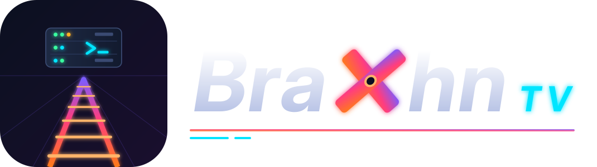

# BraXhn TV – egen mediaserver för Unraid

Svenska · [English: README.en.md](README.en.md)

<p align="center"></p>

Jag byggde BraXhn TV för att familjen skulle ha allt vi tittar och lyssnar på på ett ställe: filmer, serier, musik,
ljudböcker, poddar, foton och live-TV, på vår egen Unraid-server. Inget konto hos någon annan, ingen molntjänst och
ingen prenumeration.

Servern är skriven från grunden i Node.js, utan npm-beroenden, och använder ffmpeg för strömningen. Den levereras som
en Docker-image för amd64 och arm64. Man tittar i webbläsaren (även på TV:n med fjärrkontrollen), i appen för iPhone,
iPad och Apple TV, eller i Android-appen på Google TV och i bilen.

Eftersom vi är en svensk barnfamilj har jag lagt mycket tid på det som brukar strula för oss: svenska titlar
och dubbade barnfilmer som ska matchas rätt, barnprofiler som verkligen stoppar det som inte är för barn, och att det
ska gå att använda för den som inte är intresserad av tekniken. Webben finns på svenska och engelska.

Det är ett hobbyprojekt som jag underhåller på fritiden. Det mesta är ordentligt testat (se
[Testat och otestat](#testat-och-otestat)), men allt har inte provats på riktig hårdvara. Hör gärna av dig om något
inte fungerar.

## Innehåll

- [Installation på Unraid](#installation-på-unraid)
- [Första starten](#första-starten)
- [Uppgradera](#uppgradera)
- [Funktioner](#funktioner)
- [Namnge filer](#namnge-filer)
- [Hårdvaruomkodning](#hårdvaruomkodning)
- [Titta utanför hemmet](#titta-utanför-hemmet)
- [Appar och andra klienter](#appar-och-andra-klienter)
- [Sonarr, Radarr och scrobbling](#sonarr-radarr-och-scrobbling)
- [Säkerhet](#säkerhet)
- [Integritet](#integritet)
- [Säkerhetskopior och återställning](#säkerhetskopior-och-återställning)
- [Felsökning](#felsökning)
- [Miljövariabler](#miljövariabler)
- [Verifiera imagen](#verifiera-imagen)
- [Testat och otestat](#testat-och-otestat)
- [Stöd projektet](#stöd-projektet)
- [Repots delar, bidrag och licens](#repots-delar-bidrag-och-licens)

Mer i `docs/`: [alla funktioner i detalj](docs/funktioner.md), [guider](docs/guide.md) (live-TV, musikappar,
casting, DLNA, snabbstart), [säkerhet i detalj](docs/sakerhet.md), [testresultat](docs/testat.md) och
[API:t](docs/api.md).

## Installation på Unraid

GitHub bygger Docker-imagen automatiskt (`ghcr.io/braxhn/braxhn-tv`, amd64 och arm64), så Unraid behöver bara hämta den.

### Via Community Applications (rekommenderas)

1. Öppna fliken **Apps** (Community Applications) och sök på **BraXhn TV**.
2. Välj **braxhn-tv** – eller **braxhn-tv-nvidia** om du har ett NVIDIA-kort (installera då först pluginen *Nvidia-Driver* från Apps och starta om).
3. Peka **Media** på din mediamapp (t.ex. `/mnt/user/media`). Resten kan stå kvar: konfigurationen hamnar i `/mnt/user/appdata/braxhn-tv` och filerna ägs av `nobody:users` (PUID 99 / PGID 100) som i Unraids andra appar.
4. Klicka **Apply** och sedan **WebUI** (`http://SERVERNS-IP:8420`).

> Syns inte appen i Apps än? Mallen väntar på att godkännas i Community Applications – använd det manuella sättet nedan så länge.

### Manuellt (utan Community Applications)

1. Öppna Unraids terminal (ikonen `>_` uppe till höger) och kör:
   ```bash
   wget -O /boot/config/plugins/dockerMan/templates-user/my-braxhn-tv.xml https://raw.githubusercontent.com/BraXhn/braxhn-tv/main/braxhn-tv.xml
   ```
2. Gå till **Docker → Add Container** och välj mallen **braxhn-tv**.
3. Peka **Media** på din mediamapp och klicka **Apply**.

### Docker Compose eller docker run (andra värdar)

Repot har en [`docker-compose.yml`](docker-compose.yml). Det minsta som behövs:

```bash
docker run -d --name braxhn-tv --restart unless-stopped --security-opt no-new-privileges:true \
  -p 8420:8420 -p 8443:8443 -e PUID=1000 -e PGID=1000 -e TZ=Europe/Stockholm \
  -v /sökväg/till/config:/config -v /sökväg/till/media:/media:ro -v /tmp/braxhn-tv-transcode:/transcode \
  ghcr.io/braxhn/braxhn-tv:latest
```

Lägg till `--device /dev/dri:/dev/dri -e HWACCEL=vaapi` för grafik från Intel eller AMD.

### Bygga själv

Klona repot på servern och kör `bash install.sh`. Det bygger `braxhn-tv:local` lokalt och installerar mallen.

## Första starten

Öppna `http://SERVERNS-IP:8420` och skapa administratörskontot. Sedan startar **installationsguiden**: språk och tidszon, TMDB-nyckel (med test), förslag på bibliotek ur dina mappar, hårdvaruomkodning (med testkodning), åtkomst utanför hemmet och konton för hushållet. Allt går att hoppa över och ändra senare; guiden kan köras igen under **Administration**.

Startar den inte? Titta i loggen (Docker-fliken → ikonen → **Logs**). De första raderna visar version, arkitektur, vilken användare servern körs som, ffmpeg, grafikkort och sökvägar – och vad du ska göra om något saknas, t.ex.:

```
[start] FEL: servern (99:100) kan inte skriva i /config.
[start]   Rätta ägaren i Unraids terminal (byt sökväg om din appdata ligger någon annanstans):
[start]     chown -R 99:100 /mnt/user/appdata/braxhn-tv && chmod -R u+rwX,g+rwX /mnt/user/appdata/braxhn-tv
```

**Rättigheter (PUID, PGID, UMASK):** containern startar som root bara för att rätta ägaren på `/config` och `/transcode` (bara filer med fel ägare – går snabbt även med många bilder) och på översta mappen i `/recordings`, `/backup` och `/prestart`, och för att ge åtkomst till grafikkortet. Själva servern körs sedan som `PUID:PGID` (standard 99:100 = `nobody:users`) med `UMASK` 002, så att inspelningar och andra nya filer kan läsas och skrivas av gruppen `users` som i resten av Unraid. `PUID=0` kör som root (fungerar, men avråds). Startas containern med `--user` används inte PUID/PGID – då ändras ingen ägare och loggen säger vad som saknas.

**Egen IP-adress (Custom: br0):** välj *Network Type* `Custom: br0` och ange gärna en fast IP-adress under *Fixed IP address*. Portmappningen gäller inte då, så servern nås på containerns egen adress och porten i **Port i containern** (standard 8420). För port 80: sätt **Port i containern** till `80` och **WebUI-port** till `80`. Adressen blir då `http://CONTAINERNS-IP/`. Unraid-servern själv kan inte nå en br0-container (det är en egenskap hos macvlan) – testa från en annan dator eller telefon.

## Uppgradera

Klicka *Check for updates* i Docker-fliken och sedan *apply update* (eller låt pluginen *CA Auto Update Applications* göra det). Administratören ser **Ny version finns** i menyn och under *Administration* (med vad som är nytt och en länk till utgåvan). Servern frågar då GitHubs API om senaste utgåvan **högst en gång per dygn** – bara den frågan, inget om din server och ingen telemetri. Stäng av under *Administration* eller med `UPDATE_CHECK=0`.

Uppgraderingen är skyddad:
- **Säkerhetskopia före uppgradering:** startar en ny version mot din databas sparas först en fullständig kopia i `/config/backups/före-uppgradering-<gammal version>-<tid>.db` (de tre senaste behålls, ändra med `DB_UPGRADE_BACKUPS`). Sedan uppgraderas databasen automatiskt.
- **Ingen nedgradering som förstör data:** byter du tillbaka till en äldre image än den som senast uppgraderade databasen vägrar servern starta och skriver i loggen vad du kan göra – byt tillbaka till den nyare imagen, eller gå tillbaka till kopian från före uppgraderingen genom att kopiera den till `/config/restore.db` och starta om. `ALLOW_DOWNGRADE=1` startar ändå, på egen risk.
- **Avstängning:** Unraid stoppar containern med SIGTERM och väntar 10 s. Servern skriver då klart pågående inspelningar, stoppar omkodningar och stänger databasen ordentligt.

**Kanaler** (välj i mallens *Repository*, eller taggen i Community Applications):

| Tagg | Innehåll |
|---|---|
| `ghcr.io/braxhn/braxhn-tv:latest` | Stabila utgåvor (standard). Uppdateras bara när en version ges ut. |
| `:beta` | Förhandsversioner inför nästa utgåva. |
| `:edge` | Varje ändring direkt – nytt först, men det är du som testar. |
| `:1.0.0` / `:sha-…` | En bestämd version, för att gå tillbaka. |

## Funktioner

En översikt. Allt i detalj, med hur det fungerar, finns i [docs/funktioner.md](docs/funktioner.md).

**Bibliotek**
- Filmer, serier, musik, ljudböcker, poddar, foton, hemvideor, e-böcker och serietidningar. Flera mappar per bibliotek, och nya filer hittas direkt med filbevakning.
- Matchning mot TMDB (gratis nyckel, valfri) som klarar svenska titlar, dubbade barnfilmer och tecknat. NFO-filer och bilder från Kodi, Jellyfin och tinyMediaManager läses.
- Redigera metadata med lås per fält, flera versioner av samma film, rollista och personsidor, trailers och extramaterial, temamusik.
- Hälsokontroll av biblioteket (trasiga filer, felmärkta spår, saknade avsnitt) och en diskrådgivare som kan frigöra plats genom att koda om till HEVC/AV1.
- Inget tas bort när en disk eller nätverksresurs saknas.

**Uppspelning**
- Direktuppspelning när enheten klarar filen, annars remux eller omkodning – med Intel, AMD eller NVIDIA och tonmappning av HDR.
- Undertexter (även PGS och automatisk synk mot ljudet), nattläge och tydligare dialog, hoppa över intro och eftertexter, förhandsbilder vid spolning, bio-läge.
- Kvaliteten anpassas efter nätet utanför hemmet. Snabbstart när arraydiskarna sover. Statistik i spelaren när något hackar.
- Offline: ladda ner filmer och avsnitt i apparna, eller spara dem offline i webbläsaren.

**Startsida, sökning och upptäckt**
- Startsida med hyllor – Fortsätt titta, Min lista och tematiska hyllor som *Eftersom du såg …* – som går att ordna om.
- Sökning i hela biblioteket som klarar stavfel och å/ä/ö, och repliksökning i undertexterna.
- Egna och smarta samlingar, filter och sortering, följ serier, kalender med kommande avsnitt, Ditt år.

**Familjen**
- Profiler med PIN, barnprofiler med åldersgräns som kontrolleras på servern, skärmtid och en föräldraöversikt.
- Kvällsvalet (hushållet röstar fram kvällens film), Titta tillsammans och ett familjefilter som tystar svordomar.
- *Det här har hänt* (en sammanfattning ur förra säsongen), *Ögonblick* (klipp att dela inom hushållet) och språkinlärning med två undertexter.

**Musik, ljudböcker och poddar**
- Musikspelare med glapplös uppspelning, låttexter, musikvideor, ljudanalys och låtradio.
- Scrobbling till ListenBrainz och Last.fm, och ett Subsonic-API för musikappar som Symfonium och Amperfy.
- Ljudböcker med kapitel och bokmärken (även i poddappen via ett privat flöde), poddar, e-böcker och serier med OPDS.

**Live-TV**
- HDHomeRun och IPTV (M3U och Xtream Codes) med TV-guide, catch-up, timeshift, inspelningar och serieinspelningar.

**TV, casting och andra enheter**
- Hela webbappen går att styra med pilar, OK och Bakåt. Logga in på TV:n med en kod från telefonen.
- Chromecast, AirPlay och *Spela på…* för att styra en annan webbläsare i hemmet från telefonen. DLNA för smart-TV utan app.

**Konton och säkerhet**
- Tvåstegsverifiering, passkeys, enkel inloggning (OIDC och LDAP), delning och rättigheter per användare.
- Fjärråtkomst via eget relä utan portöppning ([BraXhn Relay](#4-braxhn-relay-utan-portöppning)).

**Drift**
- Installationsguide, uppdateringsnotis, säkerhetskopior varje natt och krypterad extern kopia, diagnostikpaket för buggrapporter.
- Sonarr och Radarr (även önskningar), Trakt, webhooks, notiser, Prometheus och import och synk av tittarhistorik från Plex och Jellyfin.

## Namnge filer

Samma namngivning som Plex, Jellyfin och Sonarr/Radarr använder fungerar:

```
/media/Filmer/Inception (2010)/Inception (2010).mkv
/media/Filmer/Arrival.2016.1080p.BluRay.x264.mkv
/media/Filmer/Arrival.2016.1080p.BluRay.x264.sv.srt     ← extern undertext
/media/Filmer/Dune (2021)/Dune (2021) - 2160p.mkv       ← två versioner av samma film
/media/Filmer/Dune (2021)/Dune (2021) - 1080p.mkv
/media/Filmer/Dune (2021)/Dune (2021)-trailer.mp4       ← trailer (eller mappen trailers/)
/media/Filmer/Dune (2021)/Featurettes/Så gjordes Dune.mkv ← extramaterial (även Behind The Scenes/, Deleted Scenes/, Interviews/ …)
/media/Filmer/Dune (2021)/Dune (2021)-deleted.mkv       ← extramaterial med Plex-suffix (-featurette, -interview, -scene …)
/media/Filmer/Dune (2021)/theme.mp3                     ← temamusik (även theme.m4a, i seriens mapp för serier)
/media/Filmer/Titanic (1997)/BDMV/STREAM/00800.m2ts     ← kopierad Blu-ray: bara huvudfilmen (största filen) tas med
/media/Serier/Bron (2011)/Season 1/Bron - S01E01.mkv
/media/Serier/Doctor Who (2005)/Season 1/...            ← årtalet skiljer serier med samma namn
/media/Barnfilm/Lejonkungen (1994) {tmdb-8587}.mkv       ← id i namnet ger exakt matchning (även [imdbid-tt…])
/media/Barnfilm/Frost 2 (svenskt tal).mkv               ← språktaggar tas bort före sökningen
/media/Barnserier/Paw Patrol/Säsong 2/Avsnitt 5.mkv     ← även "S2 A5", "Säsong 2 Avsnitt 5", "06 - Titel"
/media/Serier/Skavlan/Skavlan 2019-03-15.mkv            ← datumavsnitt matchas på sändningsdatum
/media/Musik/Artist/Album/01 Låt.flac
/media/Musik/Artist/Album/01 Låt.lrc                    ← låttext
/media/Musik/Artist/Album/01 Låt.mp4                    ← musikvideo till låten (samma namn som ljudfilen)
/media/Musik/Artist/Låt-video.mp4                        ← musikvideo, Plex-namn (även -live, -lyrics, -concert, -interview, -behindthescenes)
/media/Musik/Artist/Music Videos/Artist - Låt (Official Video).mkv  ← även mapparna "Musikvideor" och "Videos"
```

**NFO och bilder från Kodi/Jellyfin** (läses automatiskt, *Använd NFO* går att stänga av per bibliotek):

```
/media/Filmer/Inception (2010)/movie.nfo                ← eller Inception (2010).nfo
/media/Filmer/Inception (2010)/poster.jpg               ← även folder.jpg, Inception (2010)-poster.jpg
/media/Filmer/Inception (2010)/fanart.jpg               ← även backdrop.jpg, Inception (2010)-fanart.jpg
/media/Serier/Bron (2011)/tvshow.nfo
/media/Serier/Bron (2011)/poster.jpg
/media/Serier/Bron (2011)/season01-poster.jpg           ← eller poster.jpg i mappen Season 1
/media/Serier/Bron (2011)/Season 1/Bron - S01E01.nfo
/media/Serier/Bron (2011)/Season 1/Bron - S01E01-thumb.jpg
/media/Hemvideo/2023/Midsommar/IMG_0001.MOV             ← hemvideobibliotek: mapparna blir navigering
```

Allmänna namn (`movie.nfo`, `poster.jpg`, `fanart.jpg`) gäller bara när filmen har en egen mapp – ligger flera filmer i samma mapp används bara `<film>-poster.jpg` osv. NFO-filer större än 512 kB läses inte.

Samma film i flera filer slås ihop när titel och år stämmer, eller när filerna matchats till samma film i TMDB (t.ex. svensk och engelsk titel). Servern väljer den fil som passar vald kvalitet. Matchningen mot TMDB tål titlar på två språk, ett ord för mycket, "01" i stället för "del 1", kvalitets- och språkord som 1080p och *svenskt tal*, svenska, engelska och alternativa titlar. Det som inte hittas visas under *Administration → Omatchade titlar*. I en kopierad Blu-ray-mapp (`BDMV`) blir bara huvudfilmen en titel, med namnet på mappen ovanför `BDMV` – varningstexter, loggor, menyer och trailers på skivan hoppas över.

## Hårdvaruomkodning

| GPU | Inställning |
|---|---|
| Intel iGPU | `HWACCEL=vaapi` eller `qsv`, plus enheten `/dev/dri`. Tonmappning görs då på GPU:n (libplacebo via Vulkan eller VAAPI). HEVC/AV1 ut med `hevc_vaapi`/`av1_vaapi` (AV1 från Arc och Core Ultra). |
| AMD | `HWACCEL=vaapi` och `/dev/dri`. HEVC ut på de flesta Radeon, AV1 från RX 7000. |
| NVIDIA | Installera pluginen *Nvidia-Driver* från Apps och starta om. Använd sedan mallen **braxhn-tv-nvidia** (se nedan) – den har redan `HWACCEL=nvenc`, `--runtime=nvidia`, `NVIDIA_VISIBLE_DEVICES=all` och `NVIDIA_DRIVER_CAPABILITIES=all`. Tonmappningen görs på grafikkortet med libplacebo (Vulkan – kräver `NVIDIA_DRIVER_CAPABILITIES=all`, som i mallen) eller OpenCL, annars med processorn efter nedskalningen. HEVC ut på GTX 900 och senare, AV1 från RTX 40. |

Steg för steg på Unraid:
- **Intel (Quick Sync – iGPU eller Arc):** installera gärna pluginen *Intel GPU TOP* (laddar drivrutinen och visar belastningen). Fyll i **GPU-enhet** = `/dev/dri` och sätt **Hårdvaruomkodning** till `qsv` (eller `vaapi`). Loggen visar då `[start] hårdvaruacceleration: HWACCEL=qsv, enheter: /dev/dri/renderD128`.
- **AMD (Radeon eller APU):** installera gärna pluginen *Radeon TOP*. Fyll i **GPU-enhet** = `/dev/dri` och sätt **Hårdvaruomkodning** till `vaapi`.
- **NVIDIA:** installera pluginen *Nvidia-Driver* och starta om Unraid. Installera sedan **braxhn-tv-nvidia** från Apps (eller mallen nedan) – den har `--runtime=nvidia`, `NVIDIA_VISIBLE_DEVICES=all` och `HWACCEL=nvenc` från början.
- Saknas enheten, eller finns ett grafikkort som inte används, står det i loggen vid start med vad du ska ändra. Containern behöver aldrig vara *Privileged*.

Mall för NVIDIA (manuellt):
```bash
wget -O /boot/config/plugins/dockerMan/templates-user/my-braxhn-tv-nvidia.xml https://raw.githubusercontent.com/BraXhn/braxhn-tv/main/braxhn-tv-nvidia.xml
```
Har du redan containern från den vanliga mallen: välj **Edit**, sätt *Hårdvaruomkodning* till `nvenc`, slå på *Avancerad vy*, lägg till ` --runtime=nvidia` sist under *Extra Parameters* och fyll i *NVIDIA: grafikkort* (`all`).

Tar varje omkodning flera sekunder innan första bilden kommer (loggen: `[hårdvara] … tog 9.8 s innan första bilden var kodad`) startas NVIDIA-drivrutinen om för varje ffmpeg. Slå då på *persistence mode* på Unraid-värden, t.ex. med `nvidia-smi -pm 1` i ett användarskript (User Scripts) som körs när arrayen startar.

Videon avkodas också på grafikkortet (nvenc/vaapi), vilket gör 4K-HEVC mycket lättare. Fungerar hårdvaran inte går servern automatiskt över till processorn, och *Administration → Säkerhet* visar felet.

Utan GPU klarar en modern processor omkodning av 1080p i realtid. Tonmappning av 4K HDR med processor är tungt, så använd en GPU om du har mycket HDR-material.

Vilka kodare och tonmappningsvägar servern hittade står i loggen vid start (`[omkodning] ffmpeg 7.1… – HEVC/AV1: …`) och under *Administration → Omkodning*. Imagen bygger på Debian 13 (trixie) med Debians ffmpeg 7.1 för både amd64 och arm64: paketen kommer från Debians signerade paketförråd och uppdateras med imagen. jellyfin-ffmpeg har några tillägg till (t.ex. `tonemap_cuda`); servern använder dem om de finns, men imagen följer Debian för att slippa ett eget paketförråd och en egen nyckel.

## Titta utanför hemmet

Det finns fyra sätt, och de går att kombinera. Exemplen utgår från min egen uppsättning med OPNsense som router –
andra routrar och brandväggar fungerar på samma sätt. Vill du slippa öppna portar helt: se
[4. BraXhn Relay](#4-braxhn-relay-utan-portöppning).

### 1. VPN (enklast för mobil, surfplatta och dator)

Jag kör NetBird i OPNsense, så exemplet är med NetBird. Tailscale och WireGuard fungerar på samma sätt.

1. I NetBird-dashboarden, gå till **Networks** (eller *Network Routes*) och lägg till hemnätet, t.ex. `192.168.1.0/24`. Välj OPNsense-peeren som *routing peer*.
2. Installera NetBird-appen på iPhone/iPad/dator och logga in.
3. Använd samma adress som hemma: `http://192.168.1.x:8420`.

Ingenting exponeras mot internet. Om VPN-routen maskerar trafiken (standard i NetBird) ser den ut att komma från hemnätet. Utan maskering ser BraXhn TV adresser som 100.64.x.x som "utanför hemmet", och kvaliteten begränsas automatiskt. Det går att räkna VPN-nätet som hemma under *Administration → Säkerhet* (eller `TRUST_VPN_RANGE=1`).

VPN fungerar inte för bilen, Chromecast eller en Apple TV hos någon annan. Där behövs något av de andra sätten.

### 2. Egen domän med HTTPS via Nginx Proxy Manager (för bilen och Chromecast)

1. **Domän:** använd en egen domän eller en gratis DuckDNS-adress (t.ex. `braxhn.duckdns.org`). DuckDNS finns som Unraid-app och håller IP-adressen uppdaterad.
2. **Nginx Proxy Manager:** installera från Unraid Apps. Proxyns portar mappas t.ex. till 1880 (http) och 18443 (https), eftersom Unraid själv använder 80/443.
3. **OPNsense:** gå till **Firewall → NAT → Port Forward** och skapa två regler: WAN TCP 443 → Unraid-IP:18443 och WAN TCP 80 → Unraid-IP:1880. Port 80 behövs för Let's Encrypt.
4. **Proxy Host i NPM:**
   - Domän `tv.dindomän.se`, mål `http://UNRAID-IP:8420`.
   - Under SSL: *Request a new certificate*, *Force SSL* och *HTTP/2*.
   - Under Advanced:
     ```nginx
     proxy_buffering off;
     proxy_request_buffering off;
     proxy_read_timeout 3600s;
     client_max_body_size 0;
     ```
5. **BraXhn TV:** under **Administration → Inställningar → Utanför hemmet**, ange *Publik adress* `https://tv.dindomän.se` och välj maxkvalitet efter din uppladdningshastighet:

   | Uppladdning per samtidig tittare | Välj |
   |---|---|
   | minst 10 Mbit/s | 1080p |
   | minst 5 Mbit/s | 720p |

BraXhn TV litar på `X-Forwarded-For` bara när anslutningen kommer från det lokala nätet, alltså från proxyn. Inloggningsspärren mot gissade lösenord fungerar därför även bakom proxyn.

### 3. Inbyggd HTTPS med Let's Encrypt (utan proxy)

BraXhn TV kan själv hämta och förnya ett gratis certifikat från Let's Encrypt:

1. Skaffa ett domännamn som pekar på din publika IP, t.ex. `tv.dindomän.se` (eller gratis via DuckDNS).
2. I OPNsense: vidarebefordra **WAN 80 → Unraid-IP:8420** (för valideringen) och **WAN 443 → Unraid-IP:8443**.
3. Gå till **Administration → HTTPS med Let's Encrypt**, ange domänen och klicka *Hämta certifikat*. Prova gärna med *Testmiljö* först.

Certifikatet sparas i `/mnt/user/appdata/braxhn-tv/tls/`, HTTPS startar på port **8443** utan omstart, och det förnyas automatiskt 30 dagar före utgång.

Du kan också lägga ett eget certifikat som `cert.pem` och `key.pem` i samma mapp, t.ex. från OPNsense-pluginen **os-acme-client**. Förnyade filer läses in var sjätte timme.

> **Undvik Cloudflare Tunnel för video.** Cloudflares villkor begränsar videoströmning genom deras nät.

### 4. BraXhn Relay (utan portöppning)

Ungefär som Plex fjärråtkomst, men med ett relä som du kör själv: BraXhn TV ansluter själv *ut* till ett relä som du kör på en server som nås från internet (t.ex. en VPS), och nås sedan på reläets adress – utan portöppning i routern, utan VPN och utan omvänd proxy hemma. Fungerar för webben, apparna, bilen och Chromecast.

- **Reläet ligger i [`relay/`](relay/)** (Dockerfile, docker-compose med Caddy för HTTPS och [egen README](relay/README.md)). Kopiera mappen till reläservern och bygg där med `docker compose build && docker compose up -d` – ingen färdig image publiceras. Parningskoden står i `docker compose logs relay`.
- **Para hemma:** i BraXhn TV, **Administration → Fjärråtkomst via relä** (från hemnätet): ange reläets adress (t.ex. `https://tv.example.com`) och koden och klicka *Para*. Status visar *Ansluten* inom några sekunder. Sätt gärna samma adress som *Publik adress* under *Administration → Inställningar → Utanför hemmet*.
- **Säkerhet:** allt som kommer via reläet räknas alltid som **utanför hemmet** (betrott nät och hemnätets administration går aldrig att nå den vägen). Parningskoden (16 tecken, 15 minuter, en gång) och den delade hemligheten skickas aldrig över nätet; tunneln öppnas först när båda sidor bevisat hemligheten (HMAC åt båda hållen). Inloggningsspärren gäller per verklig klient-IP. Reläet ser trafiken okrypterad (som varje omvänd proxy) – kör det på en server du litar på.
- **Bandbredd:** all video går två gånger genom reläservern (in från hemmet, ut till tittaren).

## Appar och andra klienter

- **Webben:** fungerar i alla moderna webbläsare och kan installeras som app (se nedan). På TV-webbläsare (Google TV, Fire TV, LG, Samsung) styrs hela appen med pilar, OK och Bakåt.
- **iPhone, iPad och Apple TV:** en SwiftUI-app som du bygger själv med Xcode, se [apps/apple/README.md](apps/apple/README.md). Apparna finns inte i App Store. Appen följer enhetens språk (svenska eller engelska) och fungerar även via BraXhn Relay (ange reläets `https://`-adress).
- **Android (Google TV, Android TV, telefon och bilar med Android Automotive):** APK:n byggs av GitHub Actions – ladda ner den från senaste körningen av *Android Automotive-app* under *Actions → Artifacts*, se [apps/automotive/README.md](apps/automotive/README.md). *Apple-app*-körningen kontrollerar bara att koden kompilerar.
- **iPhone, iPad och Apple TV:** en SwiftUI-app som du bygger själv med Xcode, se [apps/apple/README.md](apps/apple/README.md). Apparna finns inte i App Store.
- **Android (Google TV, Android TV, telefon och bilar med Android Automotive):** APK:n byggs av GitHub Actions – ladda ner den från senaste körningen av *Android Automotive-app* under *Actions → Artifacts*, se [apps/automotive/README.md](apps/automotive/README.md). Hemma räcker serverns IP-adress (http); utanför hemmet en https-adress (BraXhn Relay, Let's Encrypt eller egen proxy – ett domännamn utan `https://` blir https). *Apple-app*-körningen kontrollerar bara att koden kompilerar.
- **Logga in på TV:n med kod:** TV:n visar en sexsiffrig kod och en QR-kod som du godkänner från telefonen.
- **Musikappar (Subsonic):** Symfonium, Amperfy, play:Sub, Feishin, Supersonic, substreamer och Music Assistant. Skapa ett eget lösenord under **Mitt konto → Musikappar** och lägg till servern som en *Subsonic*-server. Hela guiden och vad som stöds: [docs/guide.md](docs/guide.md#musikappar-subsonic).
- **Läsappar (OPDS):** under **Mitt konto → Läsappar**.
- **Chromecast** (kräver HTTPS, sätt 2–4 ovan) och **AirPlay** (Safari och Apple-apparna, fungerar hemma utan HTTPS). **Spela på…** styr en annan öppen BraXhn TV-webbläsare i hemmet från telefonen. **DLNA** för smart-TV utan app är avstängt som standard. Detaljer om alla tre och om live-TV: [docs/guide.md](docs/guide.md).

iOS/tvOS-appen finns på svenska och engelska (efter enhetens språk); Android-appen, notiserna, serverns logg, serverns felmeddelanden och offlinesidan är fortfarande bara på svenska.

### Installera som app på telefonen

- **iPhone/iPad (Safari):** öppna BraXhn TV, tryck **Dela** → **Lägg till på hemskärmen**. Användarmenyn har en knapp med samma instruktioner.
- **Android (Chrome):** användarmenyn → **📲 Installera som app**, eller Chromes meny → **Installera app**.
- Fullständig installation på Android (och snabb start utan nät) kräver att servern nås via **HTTPS** – med domännamn via Nginx Proxy Manager eller inbyggd Let's Encrypt (se *Titta utanför hemmet*). Över vanlig http hemma går det ändå att lägga en genväg på hemskärmen.

## Sonarr, Radarr och scrobbling

### Sonarr, Radarr och önskningar

- **Direkt skanning:** kopiera webhook-adressen under Administration → *Sonarr, Radarr och Trakt* och lägg in den i Sonarr/Radarr under *Settings → Connect → Webhook*. Ser Sonarr filerna under en annan sökväg (t.ex. `/tv`) anger du `/tv=/media/Serier`.
- **Önskningar:** fyll i adress och API-nyckel till Radarr/Sonarr och välj kvalitetsprofil och rotmapp. Önskningar från andra än administratörer godkänns först (eller automatiskt om du slår på det).
- **Diskrådgivaren och Radarr/Sonarr:** när Diskrådgivaren kodat om en fil till HEVC/AV1 ser Radarr/Sonarr att filen ändrats (namnet är detsamma). Har kvalitetsprofilen *Upgrades Allowed* på och en egen formatregel (*Custom Formats*) som ger x265/HEVC minuspoäng kan de vilja "uppgradera" tillbaka till en H.264-release. Ge HEVC/AV1 samma eller högre poäng (eller ta bort regeln), eller stäng av *Upgrades Allowed* för profilen när kvaliteten redan är den du vill ha. Undvik också att låta Radarr/Sonarr byta namn på filer medan en omkodning pågår.

### Scrobbling (ListenBrainz och Last.fm)

- **ListenBrainz** behöver inget av administratören: varje person kopierar sin *User token* från [listenbrainz.org/settings](https://listenbrainz.org/settings/) och klistrar in den under *Mitt konto → Scrobbling*.
- **Last.fm** kräver en API-nyckel för servern (en gång): logga in på last.fm, gå till [last.fm/api/account/create](https://www.last.fm/api/account/create), fyll i ett namn (t.ex. *BraXhn TV hemma*) och en beskrivning – *Callback URL* kan lämnas tom. Du får en **API key** och en **Shared secret**. Ange dem under Administration → *Sonarr, Radarr och Trakt* eller som `LASTFM_API_KEY`/`LASTFM_SECRET` i Unraid-mallen. Varje person trycker sedan *Koppla Last.fm* under Mitt konto och godkänner på last.fm.
- Servern märker när en låt startar (samma anrop som *Spelat nyligen* använder, så apparna behöver inte uppdateras). Startar nästa låt innan halva (eller 4 minuter) har gått räknas den förra som överhoppad. En pausad låt räknas därför ändå när tiden gått.
- Misslyckade lyssningar försöks igen med ökande väntetid (1 minut upp till 6 timmar). Last.fm tar emot lyssningar upp till 14 dagar bakåt, ListenBrainz skickas upp till 30 dagar; äldre slängs. Gäller kopplingen inte längre visas det under Mitt konto, och lyssningarna väntar tills du kopplar igen.
- Token och sessionsnycklar sparas i databasen och visas aldrig i webben eller API:t.

## Säkerhet

BraXhn TV är byggt för att kunna nås från internet. Det finns tvåstegsverifiering och passkeys, krav på 2FA utanför
hemmet, spärr mot gissade lösenord (som aldrig låser ute dig hemifrån), kortlivade strömlänkar som bara gäller en
titel, administration bara från hemnätet som standard, rättigheter och åldersgränser som kontrolleras på servern,
en strikt Content-Security-Policy, en container som inte körs som root och en säkerhetslogg. Hur varje skydd fungerar
står i [docs/sakerhet.md](docs/sakerhet.md). Hittar du en säkerhetsbrist: rapportera den privat, se
[SECURITY.md](SECURITY.md).

**Viktigt om omvänd proxy och klientens IP-adress**
- BraXhn TV avgör "hemma eller utifrån" från klientens IP. Bakom Nginx Proxy Manager läses `X-Forwarded-For` **från höger**, så en angripare kan inte förfalska en lokal adress genom att skicka headern själv.
- Proxyn **måste** skicka `X-Forwarded-For`. NPM gör det som standard.
- Annars ser alla anslutningar ut att komma från proxyns lokala adress och räknas som hemma. Det gäller också NAT-lösningar som maskerar källadressen, t.ex. en VPS-tunnel med MASQUERADE eller Cloudflare Tunnel.
- **Kontrollera** under *Administration → Säkerhetskontroll*: raden *Din adress enligt servern* ska visa din riktiga publika adress när du ansluter utifrån, t.ex. via mobilnätet.
- Om du vet proxyns adress, sätt `TRUSTED_PROXIES` (t.ex. `172.17.0.5/32`) så att bara den får ange klientadress.
- Samma sak om porten är vidarebefordrad direkt i routern men anslutningarna ändå syns med en lokal adress: vissa routrar maskerar källadressen vid portvidarebefordran ("NAT loopback"), och Docker gör det för anslutningar över IPv6 till en container utan IPv6 (docker-proxy, adressen `172.17.0.1`). Då räknas hela internet som hemma – kontrollera med *Din adress enligt servern* och använd i så fall en omvänd proxy eller `TRUST_PROXY=0` tillsammans med ett router-/Docker-läge som behåller källadressen.

**Rekommenderad konfiguration när servern nås från internet:**
1. Använd HTTPS, via Nginx Proxy Manager eller inbyggt Let's Encrypt (se ovan). Kör aldrig okrypterat över internet.
2. Aktivera 2FA eller passkeys på alla administratörskonton, och slå på *Kräv tvåstegsverifiering utanför hemmet*.
3. Låt *Administration från internet* vara avstängd. Administrera hemifrån eller via NetBird.
4. Geoblockera i OPNsense (GeoIP-alias på WAN-regeln) så att t.ex. bara Sverige och EU släpps in.
5. Valfritt: CrowdSec eller fail2ban kan läsa containerloggen. Misslyckade inloggningar loggas som `[auth] login_fail ip=… user=…`.
6. Håll containern uppdaterad, och säkerhetskopiera `/mnt/user/appdata/braxhn-tv`.

**Det här rekommenderar jag när servern nås från internet:**
1. Använd HTTPS, via Nginx Proxy Manager eller inbyggt Let's Encrypt (se ovan). Kör aldrig okrypterat över internet.
2. Slå på 2FA eller passkeys för alla administratörer, och *Kräv tvåstegsverifiering utanför hemmet*.
3. Låt *Administration från internet* vara avstängd. Administrera hemifrån eller via VPN.
4. Geoblockera i brandväggen om du kan (i OPNsense: ett GeoIP-alias på WAN-regeln), så att t.ex. bara Sverige och EU släpps in.
5. Valfritt: CrowdSec eller fail2ban kan läsa containerloggen. Misslyckade inloggningar loggas som `[auth] login_fail ip=… user=…`.
6. Håll containern uppdaterad, och säkerhetskopiera `/mnt/user/appdata/braxhn-tv`.

*Administration → Säkerhetskontroll* visar en checklista över det som bör åtgärdas.

## Integritet

**Ingen telemetri.** BraXhn TV skickar aldrig användningsdata, kraschrapporter eller statistik någonstans, och det finns inget konto hos oss. Bibliotek, tittarhistorik och inställningar stannar i `/config` på din server.

Servern kontaktar externa tjänster bara för funktioner du använder:

| Tjänst | När |
|---|---|
| TMDB (`api.themoviedb.org`, `image.tmdb.org`) | Bara med TMDB-nyckel: matchning, metadata, bilder, rollista, trailers, sändningsdatum för kalendern och *var kan jag se den?* (JustWatch via TMDB) |
| GitHub (`raw.githubusercontent.com`) | Leta efter ny version – stäng av med `UPDATE_CHECK=0` eller under Administration |
| OpenSubtitles | Bara med nyckel: sökning och nedladdning av undertexter |
| MusicBrainz, Wikidata, Wikipedia, Wikimedia Commons, LRCLIB, fanart.tv (med nyckel) | Artist- och albuminformation, bilder och låttexter för musikbibliotek – stäng av med `MUSIC_METADATA=0`/`MUSIC_LYRICS_ONLINE=0` eller i webbgränssnittet |
| Audible, Audnexus, Google Books, Open Library | Metadata och kapitel för ljudböcker – stäng av med `BOOK_METADATA=0` |
| Apple Podcasts sökning (`itunes.apple.com`) och poddarnas egna flöden | Poddar |
| Let's Encrypt | Bara med inbyggd HTTPS |
| Trakt, Last.fm, ListenBrainz | Bara när en användare kopplar sitt konto |
| Sonarr, Radarr, Plex, Jellyfin/Emby, HDHomeRun (`api.hdhomerun.com` för guiden), IPTV-leverantörer, S3, notistjänster (ntfy, Pushover, Telegram, Gotify, Discord), webhooks, OIDC/LDAP | Bara adresserna du själv anger |
| Googles Cast-SDK (`www.gstatic.com`) | Laddas **av webbläsaren** när spelaren öppnas i Chrome, för Casta-knappen |

YouTube öppnas bara om du klickar på en trailerlänk. Bilder från TMDB hämtas och cachas av servern, så hushållets webbläsare kontaktar inte TMDB – utom bildvalet under *Redigera → Bilder*, där administratörens webbläsare visar TMDB:s miniatyrer direkt.

## Säkerhetskopior och återställning

- Före varje uppgradering till en ny version sparas databasen i `/config/backups/före-uppgradering-…db` (se *Uppgradera*). Gå tillbaka genom att kopiera filen till `/config/restore.db` och starta om containern.
- Lokala kopior görs varje natt i `/config/backups`. Extern, krypterad kopia ställs in under *Statistik → Extern säkerhetskopia*. **Spara lösenfrasen på ett säkert ställe** – utan den går kopian inte att läsa.
- Återställ från webben (*Återställ* vid en kopia, starta sedan om containern) eller från terminalen: `docker exec -it braxhn-tv node server/restore.js /backup/braxhn-tv-….bxtv` och starta om.

## Felsökning

### Diagnostikpaket

Börja gärna här om du ska rapportera ett fel. *Administration → Hälsokontroll → Skapa diagnostikpaket* visar först exakt vad som följer med och laddar sedan ner ett `.tar.gz` att bifoga i en buggrapport: version, miljövariabler (nycklar, lösenord, token och adresser bara som *(satt)*), hårdvaruacceleration (`HWACCEL`, kodare, `/dev/dri`, NVIDIA), de senaste 2 000 loggraderna, databasens storlek och migreringsversion, inställningar som påverkar felsökningen och bibliotekens typ, antal och storlek. Token, nycklar, lösenord, kakor, e-postadresser och IP-adresser maskeras (`<lan-ip>`, `<vpn-ip>`, `<ip>`, `<ipv6>`). Fil- och mappnamn (bibliotekens namn och mappar, sökvägar i loggen) tas bara med om du kryssar i det. Paketet finns kvar i 15 minuter och byggs bara på begäran.

### Vanliga problem

Varje fel som beror på miljön ger en begriplig rad i loggen (*Administration → Logg*, eller Unraid → Docker → BraXhn TV → *Logs*) och de viktigaste syns i *Administration → Säkerhetskontroll*. Ingenting av det här tar bort titlar eller tittarhistorik.

| Problem | Vad du ser | Gör så här |
|---|---|---|
| Mediamappen saknas | Guiden: *Mappen /media finns inte i containern* | Docker → BraXhn TV → *Edit* → lägg till en sökväg: *Container Path* `/media`, *Host Path* t.ex. `/mnt/user/media` → *Apply*. Servern startar och visar guiden även utan mappen. |
| **Behörighet saknas** (EACCES) | Skanningen: *kunde inte läsa … – behörighet saknas (kontrollera PUID/PGID …)* | Mappen måste vara läsbar för containerns användare (Unraid: PUID 99, PGID 100). `chown -R 99:100` på mappen, eller *New Permissions* i Unraids verktyg. Titlarna i mappen ligger kvar tills den går att läsa igen. |
| NAS/SMB/NFS försvinner | *biblioteksmappen går inte att läsa – inget tas bort*, eller *N filer gick inte att läsa – nätverksresursen svarar inte* | Inget tas bort medan resursen är borta – varken när hela mappen saknas, när den ser tom ut eller när mer än hälften av filerna försvunnit. Montera resursen igen; nästa skanning (eller *Skanna*) tar vid. |
| Symboliska länkar | – | Länkar följs (även till andra diskar, t.ex. rclone/debrid). En länk till en mapp som redan ingår, eller en slinga, gås inte igenom igen. En trasig länk (målet borta) tar inte bort titeln. |
| Konstiga filnamn | *… har ett namn som inte är giltig UTF-8 och hoppas över* | Filnamnet är skrivet i en gammal teckenkodning (ofta från Windows/latin1). Byt namn, t.ex. `convmv -f latin1 -t utf8 -r --notest /mnt/user/media`. Emoji, å/ä/ö och NFD-namn från en Mac fungerar som vanligt. |
| Trasig eller halvkopierad fil | *ffprobe misslyckades … (filen verkar trasig)* | Filen läses om först när den ändras – varje timskanning försöker inte igen. 0-byte-filer och filer utan `moov` hamnar här. |
| Disken för /config är full | 507 *Disken där /config ligger är full* vid ändringar; *Databasen kan inte skriva* i säkerhetskontrollen | Uppspelning och bläddring fungerar; det som ändras (framsteg, nya titlar) sparas inte. Frigör utrymme – läget nollställs av sig själv vid första lyckade skrivning. |
| Databasen är skadad | En sida *BraXhn TV kan inte starta* på serverns adress | Sidan visar säkerhetskopiorna i `/config/backups` och kan återställa en av dem eller lägga den skadade databasen åt sidan och starta med en tom (den skadade sparas). Det krävs en engångskod som står i containerns logg. För hand: stoppa containern, kopiera en kopia till `/config/restore.db` och starta. |
| Databasen är låst | *Databasen är låst av ett annat program* | Ett annat program (sqlite3, ett backupverktyg) har filen öppen. Servern väntar 3 s per skrivning; stäng programmet. |
| TMDB går inte att nå | *TMDB går inte att nå: namnet går inte att slå upp (DNS)* / *inget svar* | Start, skanning och uppspelning fortsätter; metadata hämtas när TMDB svarar igen (titlarna markeras inte som "hittades inte"). Kontrollera DNS och brandvägg för containern. I ett nät med bara IPv6 måste TMDB nås över IPv6 eller via en proxy. |
| Hårdvaruomkodning fungerar inte | *[hårdvara] nvenc fungerar inte – använder processorn i stället* plus en *Åtgärd* | Se *Hårdvaruomkodning*. NVIDIA utan persistence mode ger en varning om lång starttid (`nvidia-smi -pm 1`). QSV kräver Intel-grafik – AMD och äldre Intel: `HWACCEL=vaapi`. |
| Lite minne / Raspberry Pi | *[minne] servern använder … av containerns gräns* | Servern läser containerns minnesgräns (cgroup) och tömmer sina cacher nära gränsen. Standardtaket för omkodningar räknas efter kärnor och minne. Visar loggen att Nodes heapgräns är större än containerns: sätt `NODE_OPTIONS=--max-old-space-size=…` som föreslås. |
| Porten är upptagen | *Port 8420 används redan av ett annat program* | Välj en annan värdport i mallen (eller `PORT`). |
| Omvänd proxy på en undersökväg | Tom sida eller 404 på `https://example.com/braxhn/` | Stöds inte: webbappen, API:t, service workern och apparna förutsätter att BraXhn TV ligger i roten. Använd en egen (under)domän, t.ex. `https://tv.example.com/` (Nginx Proxy Manager: en *Proxy Host* per domän). |

### Webbappen laddar för evigt

Webbappen läker sig själv om starten fastnar (t.ex. gamla filer från en tidigare version kvar i telefonens cache efter en uppdatering):

1. Har appen inte startat inom 10 sekunder (20 s på långsamt nät) och servern svarar, rensar den sina egna sparade filer och laddar om **en** gång. *Nedladdat* och inloggningen rörs inte.
2. Fastnar den igen visas en sida med **Rensa och ladda om** och **Försök igen**. Svarar servern inte alls rensas ingenting – då visas efter en minut *Servern svarar inte*.
3. Nödvägen för hand: öppna **`https://<din-server>/reset`** (fungerar även i hemskärmsappen och när inget annat gör det). Servern ber då webbläsaren rensa appens cache och lagring för sidan (`Clear-Site-Data`) och skickar dig tillbaka till start. **Du förblir inloggad**, men det som sparats på just den enheten försvinner: *Nedladdat* och enhetens visningsval (textstorlek, kortstorlek …).

Bra att veta:
- På iPhone har hemskärmsappen egen lagring – att radera webbplatsdata i Safaris inställningar hjälper inte den, men `/reset` gör det.
- En länk från en annan webbplats till `/reset` rensar bara cachen (som `?soft=1`) – Nedladdat och enhetens inställningar raderas bara när du själv skriver adressen, använder ett bokmärke eller trycker på knappen.
- `Clear-Site-Data` gäller bara över HTTPS (eller `localhost`). Över vanlig http hemma finns ingen service worker och därmed ingen sådan cache; där rensar `/reset`-sidan det den kan med JavaScript.
- En ny version tas i bruk av sig själv vid nästa start: startsidan hämtas alltid från servern först och ur cachen bara om servern inte svarar inom tre sekunder.

## Miljövariabler

| Variabel | Standard | Beskrivning |
|---|---|---|
| `PORT` / `HTTPS_PORT` | 8420 / 8443 | Webbportar |
| `MEDIA_ROOT` | /media | Bibliotek måste ligga här |
| `HWACCEL` | none | none, vaapi, qsv, nvenc eller auto (NVIDIA-enhet → nvenc, `/dev/dri` → vaapi, annars processorn). Vanliga felskrivningar tolkas (`nvidia` → nvenc, `intel`/`amd` → vaapi, `off` → none). Fungerar inte valet används processorn, och varför syns i loggen, guiden och säkerhetskontrollen |
| `HW_DECODE` | 1 | 0 = avkoda med processorn även när grafikkortet kodar |
| `GPU_FILTERS` | 1 | 0 = skala och färgkonvertera med processorn även när grafikkortet kan (felsökning). Annars stannar bilderna på grafikkortet hela vägen (NVIDIA/Intel/AMD), som i Plex |
| `TZ` | Europe/Stockholm | Tidszon för skärmtid, inspelningar och nattliga säkerhetskopior |
| `LOG_TIME` | 1 | 0 = ingen tidsstämpel på loggraderna |
| `TONEMAP` | hable | hable, mobius, reinhard eller bt2390 (libplacebo använder bt2390 om inget anges) |
| `TRANSCODE_VCODEC` | auto | Videoformat vid omkodning (kan även ändras under *Administration → Omkodning*): auto = HEVC/AV1 med grafikkortet när klienten klarar det, cpu = även med processorn (x265/SVT-AV1), h264 = alltid H.264 |
| `X265_PRESET` / `SVTAV1_PRESET` | veryfast / 10 | Hastighet för processorns HEVC- och AV1-kodare (4K: superfast / 12) |
| `GPU_TONEMAP` | 1 | 0 = tonmappa aldrig med libplacebo/OpenCL på grafikkortet (felsökning) |
| `PUBLIC_URL` | – | Publik adress, t.ex. https://tv.dindomän.se |
| `REMOTE_QUALITY` | 1080 | Maxkvalitet utanför hemmet |
| `TRUST_PROXY` | auto | 1 = lita alltid på X-Forwarded-For, 0 = aldrig |
| `HSTS` | 1 | 0 = skicka inte HSTS-header via HTTPS |
| `TMDB_API_KEY` / `OPENSUBTITLES_API_KEY` | – | Valfria nycklar (kan även sättas i webbgränssnittet) |
| `SCAN_INTERVAL` | 60 | Minuter mellan skanningar |
| `PHOTO_HEIC` | auto | 1 = läs HEIC/HEIF-bilder även om ffmpeg-versionen ser för gammal ut, 0 = hoppa alltid över dem. Standard: på med ffmpeg 7.1 eller senare |
| `TRUSTED_NETWORKS` | – | Extra betrodda nät (CIDR, minst /16) utöver hemnätet |
| `TRUSTED_PROXIES` | privata adresser | Vilka proxyadresser som får ange klientens IP via X-Forwarded-For |
| `TRUST_VPN_RANGE` | 0 | 1 = räkna 100.64.0.0/10 (NetBird/Tailscale/CGNAT) som hemma |
| `ADMIN_ANYWHERE` | 0 | 1 = tillåt administration från internet (avråds) |
| `RELAY_HEARTBEAT_MS` | 15000 | Millisekunder mellan hjärtslagen i tunneln till BraXhn Relay (reläets egna variabler `RELAY_*`: se *Fjärråtkomst via BraXhn Relay*) |
| `OIDC_CLOCK_SKEW` | 120 | Tillåten klockavvikelse i sekunder mot leverantören för enkel inloggning (ID-tokens giltighetstid) |
| `OIDC_ALLOW_PRIVATE` | 0 | 1 = leverantörens övriga adresser (token, nycklar) får ligga på loopback/länklokalt – utfärdarens egen värd är alltid tillåten (tester, särskilda installationer) |
| `MAX_TRANSCODES` / `MAX_TRANSCODES_USER` | auto / 2 | Tak för samtidiga omkodningar. Utan värde: 4 med grafikkort; med processorn efter kärnor och minne (4 kärnor → 4, 2–3 → 2, 1 → 1; under 3 GB minne högst 2, under 1,5 GB 1) |
| `STREAM_NICE` / `LOOP_LOG_MS` | 3 / 250 | Strömmens ffmpeg körs så mycket lägre prioritet (nice) än servern själv, så att segmenten alltid hinner skickas (0 = samma). Stopp i serverns händelseslinga längre än `LOOP_LOG_MS` ms loggas med de bakgrundsjobb som pågick |
| `ACME_DOMAIN` / `ACME_EMAIL` | – | Domän och e-post för Let's Encrypt (kan även sättas i webbgränssnittet) |
| `WATCH_FILES` | 1 | 0 = stäng av filbevakning |
| `TRICKPLAY` | 1 | 0 = skapa inga förhandsbilder för spolning |
| `SUBINDEX` | 1 | 0 = indexera inga undertexter för repliksökningen |
| `HEALTH` | 1 | 0 = ingen hälsokontroll av biblioteket (kan också slås av i vyn) |
| `HEALTH_SAMPLES` | 5 | Stickprov per fil som avkodas i hälsokontrollen (0–20) |
| `SHRINK_WINDOW` | 01:00-07:00 | Diskrådgivarens tidsfönster för omkodning (lokal tid, tomt = hela dygnet; kan ändras i vyn) |
| `SHRINK_TRASH_DAYS` | 14 | Dagar som originalet ligger i papperskorgen efter en omkodning (kan ändras i vyn) |
| `SHRINK_TRASH_DIR` | – | Egen mapp för papperskorgen (standard `.braxhn-papperskorg` i biblioteksmappen; en mapp på ett annat filsystem gör att originalet kopieras i stället för att flyttas) |
| `SHRINK_X265_PRESET` / `SHRINK_SVTAV1_PRESET` | medium / 6 | Förinställning för processorns kodare i Diskrådgivaren |
| `DVR_DIR` | /recordings | Var inspelningar sparas |
| `PODCAST_DIR` | /config/podcasts | Var nedladdade poddavsnitt sparas |
| `NOTIFY_KIND` / `NOTIFY_URL` / `NOTIFY_TOKEN` / `NOTIFY_USER` | – | Notiser (kan även sättas i webbgränssnittet) |
| `UPDATE_CHECK` | 1 | 0 = leta inte efter nya versioner. På: ett anrop till GitHubs API (senaste utgåvan) högst en gång per dygn, inget om servern skickas |
| `DB_UPGRADE_BACKUPS` | 3 | Antal säkerhetskopior av databasen från före uppgraderingar som behålls i `/config/backups` |
| `ALLOW_DOWNGRADE` | 0 | 1 = starta även mot en databas från en nyare version (nedgradering, på egen risk) |
| `HISTORY_DAYS` | 365 | Hur många dagar tittarhistoriken sparas (0 = för alltid; kan även sättas under Tittarstatistik) |
| `WEBHOOK_INTERVAL` | 10 | Sekunder mellan genomgångar av webhook-kön (0 = av) |
| `RADARR_URL` / `RADARR_API_KEY` / `SONARR_URL` / `SONARR_API_KEY` | – | Sonarr/Radarr (kan även sättas i webbgränssnittet) |
| `TRAKT_CLIENT_ID` / `TRAKT_CLIENT_SECRET` | – | Din Trakt-app |
| `LASTFM_API_KEY` / `LASTFM_SECRET` | – | Last.fm-appens API key och Shared secret för scrobbling (kan även sättas i webbgränssnittet, se *Scrobbling*) |
| `SUBSONIC` | 1 | 0 = stäng av API:t för musikappar (`/rest`); kan även ändras i Administration → Säkerhet |
| `S3_ENDPOINT` / `S3_BUCKET` / `S3_ACCESS_KEY` / `S3_SECRET_KEY` / `BACKUP_PASSPHRASE` | – | Extern säkerhetskopia |
| `WATCH_REGION` | SE | Land för *var kan jag se den?* |
| `PUID` / `PGID` | 99 / 100 | Användaren servern körs som och ägare till filerna i /config (Unraid: `nobody:users`). 0 = root (avråds) |
| `UMASK` | 002 | Rättigheter för nya filer: 002 = gruppen får skriva (Unraid), 022 = bara ägaren |
| `LIVE_TIMESHIFT_MINUTES` | 120 | Minuter live-TV sparas bakåt (0 = av, max 720) |
| `LIVE_TIMESHIFT_MAX_GB` | 20 | Diskutrymme för timeshift, alla kanaler tillsammans |
| `IPTV_ALLOW_PRIVATE` | 0 | `1` = adresser i IPTV-listor får gå till alla nät (även `localhost`) – bara för särskilda installationer |
| `DVR_COMSKIP` | 1 | 0 = leta inte reklamavbrott i inspelningar |
| `CREDITS_PER_SCAN` | 40 | Äldre titlar per skanning som får rollista och trailer från TMDB (0 = av) |
| `MUSIC_LOUDNESS` / `MUSIC_LOUDNESS_PER_SCAN` | 1 / 200 | Mät ljudstyrka för spår utan ReplayGain-taggar, och hur många per skanning |
| `MUSIC_GAPLESS` | 1 | 0 = analysera inte låtarna för glapplöst och övertoning (kodarfördröjning och tystnad i kanterna) |
| `MUSIC_SONIC` / `MUSIC_SONIC_SECONDS` | 1 / 120 | Ljudanalys av musik i bakgrunden (0 = av helt, annars styrs den i Administration), och hur många sekunder från mitten av varje låt som analyseras (20–120) |
| `CALENDAR_REFRESH` / `CALENDAR_GAP_MS` | 1 / 1500 | 0 = hämta inga sändningsdatum från TMDB; millisekunder mellan TMDB-anropen för kalendern |
| `TMDB_API_URL` | https://api.themoviedb.org/3 | Annan adress till TMDB:s API (för test) |
| `TMDB_IMAGE_URL` | https://image.tmdb.org/t/p | Annan adress till TMDB:s bilder (för test) |
| `IMAGE_UPLOAD_MAX_MB` | 15 | Största bild som administratören kan ladda upp under *Redigera → Bilder* |
| `NEW_EPISODE_NOTIFY_DELAY` | 600 | Sekunder som nya avsnitt samlas innan den personliga notisen skickas |
| `PRESTART_DIR` | /prestart om mappen är monterad | Snabbstart: mapp på snabb lagring (cache-poolen) för början av troliga titlar. Tomt = bara väckning i förväg |
| `PRESTART_MAX_GB` | 20 | Snabbstart: största storlek (kan ändras i webbgränssnittet) |
| `PRESTART_SECONDS` | 90 | Snabbstart: sekunder av början (och efter platsen där man slutade) som kopieras |
| `PRESTART_MBPS` | 40 | Snabbstart: högsta kopieringshastighet i MB/s |
| `PRESTART_AWAKE_MIN` | 10 | Snabbstart: hur länge en disk räknas som vaken efter att servern läst i samma mapp (när disken inte syns i `/sys/block`) |
| `DISK_MIN_PCT` / `DISK_MIN_GB` | 10 / 10 | Varna när ledigt utrymme är under gränsen (0 = av) |
| `METRICS_TOKEN` | – | Bearer-token för `/metrics` (kan även skapas på adminsidan) |
| `DLNA` / `DLNA_IP` / `DLNA_SSDP` | 0 / auto / 1 | Slå på DLNA, adress som annonseras, och SSDP-annonsering |
| `BOOK_METADATA` | 1 | 0 = hämta ingen metadata eller kapitel för ljudböcker från nätet (kan även ändras i webbgränssnittet) |
| `MUSIC_METADATA` | 1 | 0 = hämta ingen artist- eller albuminformation från nätet (kan även ändras i webbgränssnittet) |
| `MUSIC_LYRICS_ONLINE` / `MUSIC_LYRICS_BACKGROUND` | 1 / 0 | Låttexter från LRCLIB när de öppnas; 1 = hämta dem även i förväg efter skanningen |
| `MUSIC_META_CONTACT` | – | Kontaktadress (e-post eller webbadress) i User-Agent till MusicBrainz, t.ex. `du@exempel.se` (kan även anges i webbgränssnittet) |
| `FANART_API_KEY` | – | Personlig nyckel från fanart.tv för artistbilder och bakgrunder (valfri) |
| `MUSICBRAINZ_URL` / `WIKIDATA_URL` / `WIKIPEDIA_URL` / `COMMONS_URL` / `FANART_URL` / `LRCLIB_URL` | de publika tjänsterna | Andra adresser till källorna för musikmetadata och låttexter (används av testerna; `WIKIPEDIA_URL` med `{lang}`) |
| `MUSICBRAINZ_GAP_MS` / `MUSIC_META_GAP_MS` | 1100 / 250 | Millisekunder mellan anropen till MusicBrainz respektive övriga källor |
| `GOOGLE_BOOKS_URL` / `OPENLIBRARY_URL` / `OPENLIBRARY_COVERS_URL` / `AUDNEXUS_URL` / `AUDIBLE_URL` | de publika tjänsterna | Andra adresser till källorna för ljudboksmetadata (används av testerna) |
| `AUDIBLE_REGION` | us | Audible-butiken för metadatasökning (us, uk, de, fr, ca, au, it, es, in, jp) – kan ändras i webbgränssnittet |
| `BOOK_TRASH_DAYS` | 14 | Dagar som originalen ligger i papperskorgen efter *Slå ihop till M4B* eller *Skriv in i filen* |
| `MOMENTS_MAX_SECONDS` | 180 | Längsta *Ögonblick* (klipp) i sekunder (5–600) |
| `MOMENTS_MAX_MB` | 2048 | Lagringsgräns för alla ögonblick tillsammans (i `/config/moments`); fullt = nya ögonblick nekas |
| `MOMENTS_JOBS` | 1 | Samtidiga ffmpeg-jobb för ögonblick (1–4, lägsta prioritet) |
| `RECAP_OFFER_DAYS` | 14 | Dagar utan tittande på serien innan spelaren erbjuder *Det här har hänt* vid en ny säsong |
| `RECAP_MAX_MB` | 2048 | Lagringsgräns för sammanfattningarna (i `/config/recaps`); de äldst använda tas bort först |
| `RECAP_KEEP_DAYS` | 30 | Dagar en oanvänd sammanfattning sparas |
| `RECAP_JOBS` | 1 | Samtidiga sammanfattningar som klipps ihop (1–2, lägsta prioritet) |

## Verifiera imagen

Imagen signeras med Sigstore när den byggs:

```
cosign verify ghcr.io/braxhn/braxhn-tv:latest \
  --certificate-identity-regexp 'https://github.com/BraXhn/braxhn-tv/' \
  --certificate-oidc-issuer https://token.actions.githubusercontent.com
```

## Testat och otestat

Hela testsviten (`npm test`, runt 30 minuter) körs före varje Docker-image, mot riktiga mediafiler som skapas med
ffmpeg, och webbgränssnittet testas i Chromium vid telefon-, dator- och TV-storlek. Sviten går även som vanlig
användare utan skrivrätt till `/config`. Vad varje funktion testades med står i [docs/testat.md](docs/testat.md).

Det jag inte har kunnat prova här:

- inbränning av andra bildundertexter än PGS (DVD/DVB)
- GPU-omkodning och VAAPI-tonmappning
- HEVC/AV1 med grafikkortet (hevc/av1_nvenc, hevc/av1_vaapi, hevc/av1_qsv) och tonmappning med libplacebo, tonemap_opencl och tonemap_cuda på riktiga grafikkort – bara kommandoraderna och sonderingen är testade
- Dolby Vision profil 5 med riktig RPU (ffmpeg kan inte skapa en), och HEVC/AV1-strömmarna i Safari/iPhone, Chrome och Edge på riktigt
- Docker-imagen för arm64 (paketen finns för arm64 i Debian; bara amd64-imagen byggdes och provades)
- OpenSubtitles (API:t var inte nåbart härifrån)
- Chromecast på riktigt (bara med en låtsad Cast-SDK) och AirPlay
- certifikat från Let's Encrypt på riktigt (kräver en publik domän)
- IPTV mot riktiga leverantörer (Xtream-paneler skiljer sig åt, särskilt catch-up-adressernas tidszon), Flussonic-servrar, tusentals kanaler på en riktig TV-webbläsare och uppspelning av bilden i catch-up/VOD-spelaren (Chromium i testmiljön saknar H.264)
- en riktig HDHomeRun, riktig IPTV, riktiga Sonarr/Radarr, Trakt, ListenBrainz, Last.fm och S3-lagring (simulerade här)
- Google TV-appen på en riktig TV (bitström till förstärkare, HDR/Dolby Vision, bildfrekvensväxling) och ljudböcker i bilen
- Android-appen i Android Auto, bild-i-bild på en riktig telefon och Google TV:s rad *Fortsätt titta* (Watch Next)
- Android-appen 0.7.0 på riktig enhet: att 60 s tidsgräns räcker mot omkodning med grafikkort, Stoppa från Föräldraöversikten och skärmtidens stopp i spelaren, poddar dolda för barnprofiler i bilen, fokus och Bakåt med Google TV:s fjärrkontroll, https via BraXhn Relay och ett eget certifikat installerat på telefonen
- Android-appens TV-guide, kanalbyte med fjärrkontrollens knappar, catch-up/IPTV-filmer, temamusik, betyg, extramaterial, repliksökning och undertextsynk – svaren är kontrollerade mot kontraktet, men appen har inte kompilerats eller körts här (uppspelning av IPTV-film/catch-up och framsteg för IPTV-filmer kräver en Xtream-källa och finns inte i kontraktstestet)
- passkeys i en riktig webbläsare/telefon
- enkel inloggning mot riktiga leverantörer (Authentik, Authelia, Keycloak, Google, Microsoft Entra) och kataloger (Active Directory, lldap, OpenLDAP, FreeIPA) – bara simulerade här; apparna har ingen knapp för OIDC (LDAP-kontot fungerar med vanlig inloggning i apparna)
- riktiga skärmläsare (NVDA, JAWS, VoiceOver, TalkBack) och Windows högkontrast på riktigt – bara roller, namn och live-regioner i Chromium och emulerad forced-colors
- inloggning med kod i Apple TV- och Google TV-appen och i en riktig TV-webbläsare
- offline-nedladdning och musik i en riktig bil
- CarPlay (kräver ett särskilt tillstånd från Apple och är därför inte byggt)
- Docker-bygget
- BraXhn Relay bakom Caddy/Nginx och Let's Encrypt på en riktig VPS, reläets Docker-image, och apparna och Chromecast via reläet
- apparna, som byggs via GitHub Actions (se respektive README) – bl.a. sovtimer, rollista, smarta listor, Nytt för dig och automatisk offline-synk, och i iOS/tvOS-appen live-TV, guide och inspelningar, profilbyte med PIN, Min lista, startsidans nya hyllor, bio-läge och nattläge/tydligare dialog
- iOS/tvOS-appen på riktiga enheter efter omarbetningen för 1.0: väntan på grafikkortets första segment (förklaringen efter 4 s, nya försök med samma ström), Föräldraöversiktens *Stoppa* och skärmtiden i spelaren och ljudspelaren, att poddarna döljs för barnprofiler, inloggning och strömning/AirPlay via BraXhn Relay, de engelska texterna och Siri Remote-fokus i felrutorna – svaren är kontrollerade med kontraktstestet, Swift-koden kompileras bara i GitHub Actions (Swift-koden har inte kompilerats här; serverns svar är kontrollerade med kontraktstestet)
- anpassningsbar kvalitet i Safari, AVPlayer, ExoPlayer och Chromecast
- timeshift i Safari/AVPlayer och reklamdetektering på riktiga sändningar
- DLNA mot en riktig TV, och import mot riktiga Plex- och Jellyfin-servrar (plex.tv:s växling av hemanvändare och `resources`, och en riktig `com.plexapp.plugins.library.db` från en aktuell Plex-version, är simulerade efter Plex dokumenterade/kända format)
- TMDB-rollistor och personbilder mot riktiga TMDB (simulerat här)

## Stöd projektet

BraXhn TV är gratis och utan reklam, och så förblir det. Vill du hjälpa till med kostnaderna och med att jag kan göra
en riktig iOS-app kan du donera via [PayPal](https://paypal.me/braxhn) – helt frivilligt. Samma länk finns diskret
under *Mitt konto* och *Administration* (aldrig för barnprofiler, och en administratör kan dölja den). Servern
kontaktar aldrig PayPal; det sker först om du själv klickar på länken.

## Repots delar, bidrag och licens

```
server/   Node.js-server (inga npm-beroenden): API, skanner, strömning, intro-detektering
web/      Webbgränssnitt (fungerar i alla webbläsare, installerbart som webbapp)
apps/apple/       App för iPhone, iPad och Apple TV (SwiftUI)  → se apps/apple/README.md
apps/automotive/  Android-app för bilen (Android Automotive, t.ex. Polestar 4) och Google TV/Android TV (Kotlin) → se apps/automotive/README.md
braxhn-tv.xml     Unraid-mall (Community Applications), braxhn-tv-nvidia.xml för NVIDIA, ikon i unraid/
                  Dockerfile / docker-compose.yml / install.sh
```

Bidrag och buggrapporter är välkomna – se [CONTRIBUTING.md](CONTRIBUTING.md). Säkerhetsbrister rapporteras enligt
[SECURITY.md](SECURITY.md). Hur koden hänger ihop: [docs/utvecklarguide.md](docs/utvecklarguide.md) och
[docs/arkitektur.md](docs/arkitektur.md). Vad som ändrats: [CHANGELOG.md](CHANGELOG.md).

Licens: MIT, se [LICENSE](LICENSE).
